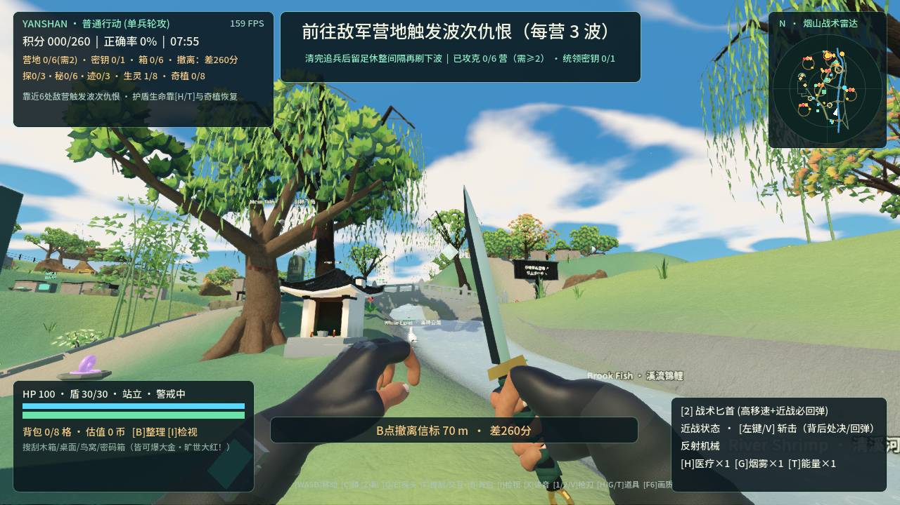
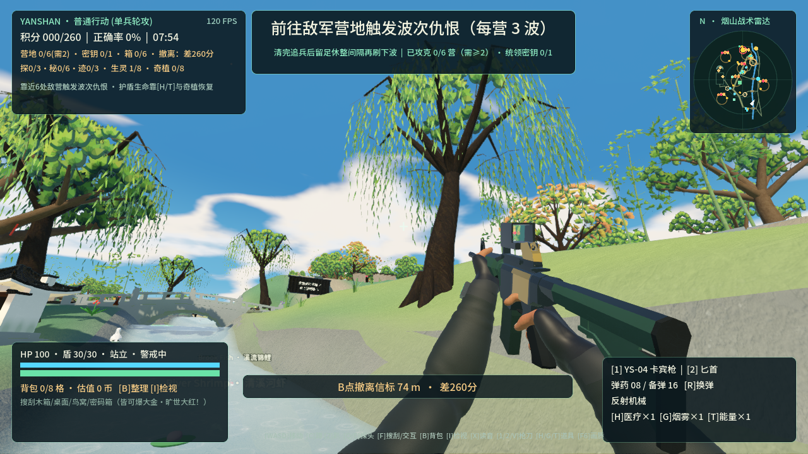
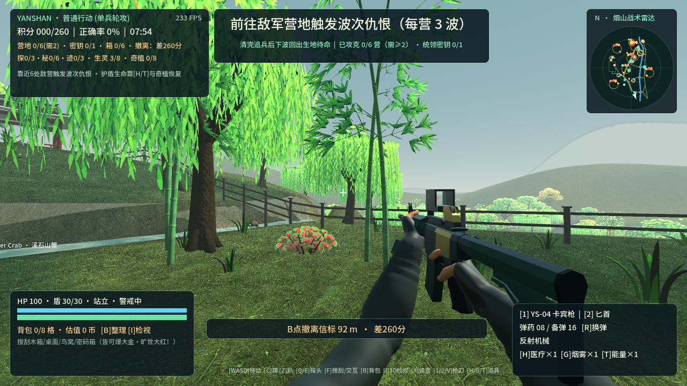
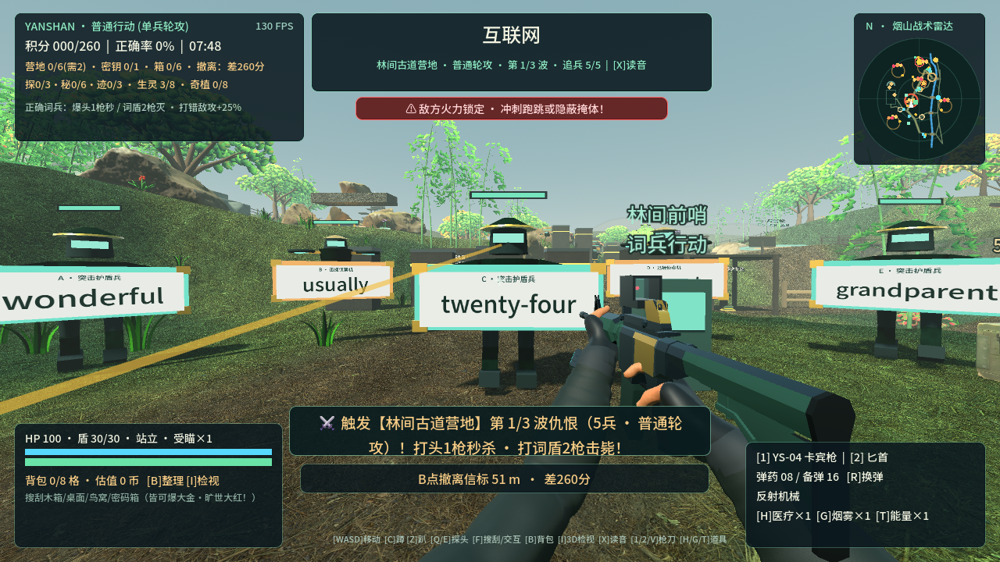
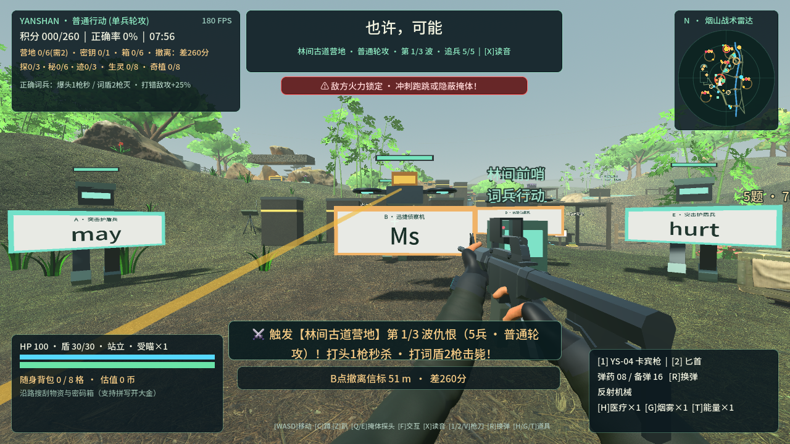
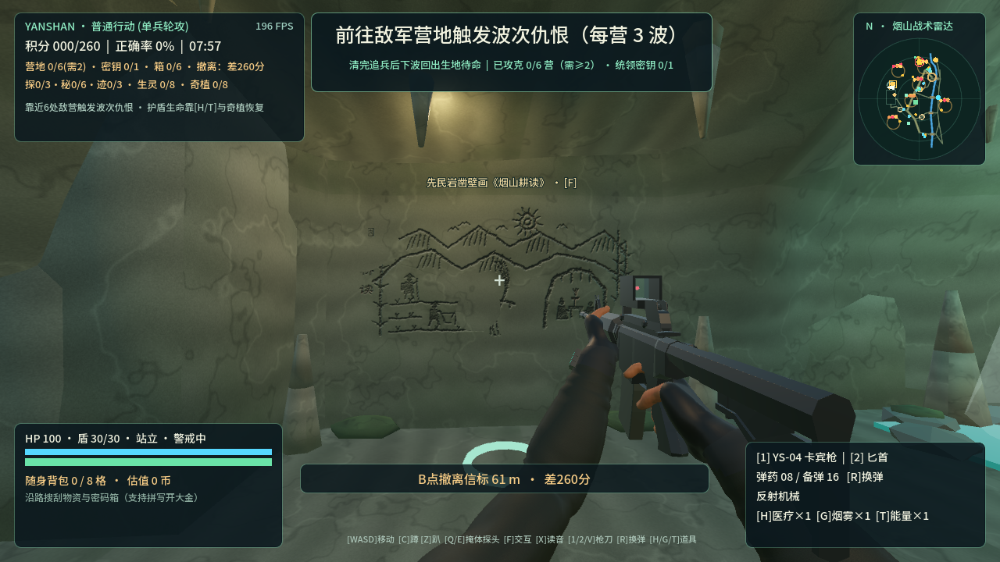
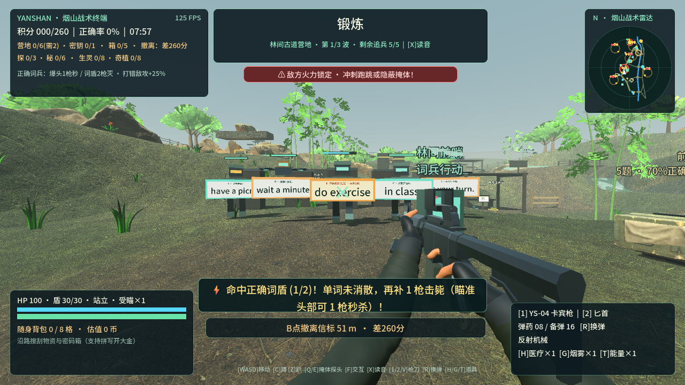
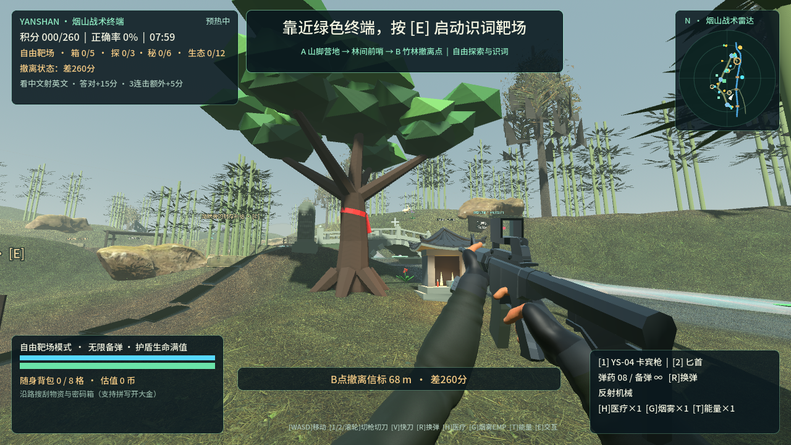
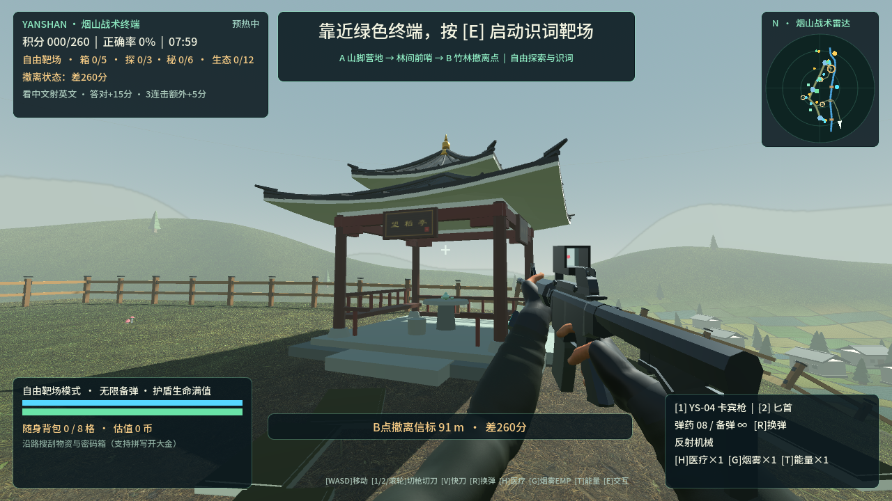

# 烟山行动 · Yanshan Force

> **结合家乡江南小村风貌与小学英语学习，利用 AI 协同开发的 3D 第一人称英语“搜打撤”游戏（Godot 4.7.2）**  
> An open-source 3D FPS English-learning extraction game inspired by a Jiangnan countryside village, built with AI collaboration to help primary school students master English vocabulary, phrases, and sentences.


---

## 项目初心 · Why We Built This

这个项目的起点很单纯：**想让正在读小学的孩子真正愿意学英语、反复记单词，而不只是枯燥抄写。**

因此我们把 **家乡江南小村与丘陵山野**（诚庄村外的成片稻田、白墙黑瓦农舍、蜿蜒竹林山溪）搬进了 3D 世界，结合孩子喜欢的第一人称战术“搜打撤”（搜刮 → 作战破译 → 撤离）玩法，借助 AI 工具在代码、3D 建模（Blender 4.5）、程序化贴图与音效合成上协同推进，做成了这套 **完全离线、轻量流畅（面向核显优化）、可自由扩展词库** 的学习游戏。

本项目代码以 **[MIT License](LICENSE)** 完全开源，美术/音频资产均遵循 `CC0` / `CC BY 4.0` / `OFL-1.1` / `MIT` 等开放协议，**欢迎各位家长、老师、学生和开发者任意 Fork、魔改、替换词库与二次开发！**

---

## 实机画面 · Screenshots (`v0.6.6`)

| 普通行动 3~4 兵依托高低垛口半身矮垣谨慎探射（`v0.6.6`） | 词盾破损（1/2）机动换掩体 + 移动压制点射弹道（`v0.6.6`） |
| :---: | :---: |
|  |  |

| 晴空云海、金绿水镜梯田与徽派马头墙古村远眺（`v0.6.5`） | 溪畔徽派粉墙黛瓦土地石龛、古樟红绸与晴空积云（`v0.6.5`） |
| :---: | :---: |
|  |  |

| 春风垂柳、修篁翠竹与晴空暖金积云（`v0.6.5`） | 据点清波 `15s+15s` 共 `30s` 从容搜刮窗口（`v0.6.6`） |
| :---: | :---: |
|  |  |

| 第一人称双手武术持刀戒备（双肩后锁 · 告别断臂悬空） | 爆发斜劈与青瓷金锋刀光弧面（双袖自屏幕底角自然延展） |
| :---: | :---: |
|  |  |

| 多分件苍青错金 `YS-04` 卡宾枪与青绿垂柳溪谷 | 团簇青绿水墨树竹、丝绦垂柳与乌桕丹枫秋色点缀 |
| :---: | :---: |
|  |  |

| 八角须弥青石案（旷世大红青瓷盏）与盘枝三蛋鸟窝 | 飞檐斗笠盔 + 古铜包角词盾「烟山演武机关词卫」 |
| :---: | :---: |
|  |  |

| 密码箱「放大镜逐格蓄力揭晓」与奇迹出大红 | `[I]` 独立双光源 3D 宝物旋转检视台（双语考据） |
| :---: | :---: |
|  |  |

| 普通行动（单兵轮攻+半命中，其余4兵伴随不进攻） | 机密行动（5兵协同高危围剿 · 战利品估值 `×1.35`） |
| :---: | :---: |
|  |  |

| 「迷踪竹石阵」青石牌坊与翠竹奇石入口 | 阵心太湖奇石矮拱（`[C]` 蹲伏潜行捷径）与石灯 |
| :---: | :---: |
|  |  |

| 「烟霞古洞」前厅无框原生石壁岩凿壁画《烟山耕读》 | 内室「一线天光」寒潭、石砌茶灶与先民古竹简 |
| :---: | :---: |
|  |  |

| 5 兵波次追击与词盾首枪破裂（`1/2`） | 高空盘旋白鹭射击命中与白羽化光 |
| :---: | :---: |
|  |  |

| 备战营地与枪匠改装台 | 掩体蹲伏右探闪身射击（`[C]` + `[Q/E]`） |
| :---: | :---: |
|  |  |

| 古樟小松鼠攀树躲避与山坡赤狐 | 南界山溪顺坡出流与村落垂柳 |
| :---: | :---: |
|  |  |

| 下切鹅卵石山溪与有节毛竹林 | 百年古樟、土地石龛与青石板古道 |
| :---: | :---: |
|  |  |

| 东岭「望稻亭」重檐飞檐 | 青石单孔拱桥与「烟山古境」界碑 |
| :---: | :---: |
|  |  |

---

## 核心特性 · Features

- **智战烟山 · 词兵谨慎掩体战术 AI、动态随机兵力与 30 秒休整窗口（`v0.6.6`）**：彻底告别旧版词兵直线贴脸死追的机械逻辑——每处营地布置 **6 座宽距双排高低垛口矮垣与天然山石树干掩体池**，词兵智能认领空闲掩体闪身探射，并在换位或词盾破损（`1/2`）疾跑途中朝玩家进行**移动压制点射**（内置答案词盾防遮挡保护与 `0.72m` 护腿矮翼，确保英文选项始终清晰可读可打）；普通行动每波随机 **`3 ~ 4` 名词兵**谨慎周旋（仅作 `44m` 内小范围出营追击），机密行动每波随机 **`3 ~ 6` 名词兵**展开交替掩护跃进；清波后延长为 **`15s` 空营刷新间隔 + `15s` 休整免战期（共 `30s` 从容搜刮窗口）**。
- **晴云烟山 · 太平村云海梯田美学与 Vulkan Forward+ 双档渲染（`v0.6.5`）**：对标《太平村·江南云海梯田山境》重塑全图明朗青绿云海视觉——升级 **`Vulkan Forward+`** 现代桌面管线（配套 `[F6]` 一键切换核显均衡流畅档），实装程序化 **晴空暖金立体积云天幕（`shader_type sky`）**、**冷青暗部→暖金春芽树冠色相推移 + 相机朝向泼墨笔触微片**、**阳光金绿稻浪与水镜梯田**、**山腰云海雾带与四重向阳奇峰**及 **全图徽派「粉墙黛瓦·三级马头墙」民居/石龛**。
- **双手锁肩近战动作与枪械风物精雕（`v0.6.4`）**：重构 39 骨骼第一人称双臂（双肩封口拓扑 + 锁肩正向双骨 IK + 左右双手武术持刀戒备 + 青瓷金锋新月刀光弧面），彻底根除近战挥刀“孤独断臂”穿帮；并全面精雕 6 材质分件苍青错金 `YS-04` 卡宾枪、伞绳缠柄 `竹影青锋` 战术短刀、八角青石须弥座石案、28 枝盘织三蛋鸟窝与飞檐斗笠盔机关词卫。
- **真摸金 6 阶大红爆率、放大镜悬念揭晓与双语奇珍图鉴（`v0.6.3`）**：构建《三角洲行动》风格 6 阶稀有度（普通 → 传说大金 → **旷世·大红 `#ff4757`**）与动态成色估值体系（战损/标准/崭新/极品孤本），扩充至 **31 件中英双语江南风物与战术藏品**（【烟山之心·赤金龙印】【越窑秘色青瓷盏】【烟山千年紫芝王】等）；开箱采用**声呐读条放大镜逐格蓄力揭晓**（大金金色信号、大红超高能波形+重低音心跳号角）；全图每局动态刷新 **3D 露天刷货台（金/红冲天光柱）**、**树丫鸟窝/太湖石缝摸宝**、**金色高能异动箱**与**词兵波次掉落包（零失误升阶精英无瑕箱）**；配套 `[B]` 4 列随身摸金背包、`[I]` 360° 旋转 3D 宝物检视台与营地 **【🏆 烟山奇珍图鉴】**。
- **普通 / 机密双行动模式与原生石壁岩画（`v0.6.2.1`）**：参考《三角洲行动》提供 **「普通行动（5兵伴随亮词、单兵轮流主攻 + 半额追击命中）」** 与 **「机密行动（5兵协同高危围剿、全额命中 + 全图战利品与首领估值 `×1.35` + 密码箱大金爆率 `+12%`）」** 双分级体验；并将「烟霞古洞」前厅壁画重塑为无任何人工边框、直接阴刻于起伏喀斯特灰岩上的千年先民岩凿壁画《烟山耕读》与《烟霞古洞志》。
- **迷踪竹石阵、烟霞古洞与千年烟山秘史（`v0.6.2`）**：在西岭诗碑亭北麓辟出太湖奇石与毛竹交错的多岔迷宫 **「迷踪竹石阵」**（含南门石坊、`[C]` 蹲伏钻行的奇石矮拱捷径、古石日晷秘藏与摩崖石刻《竹石清音》），北接双厅纵深溶洞 **「烟霞古洞」**——前厅刻有先民岩画与古洞题志，内室「一线天光」斜映洞中寒潭、石砌余烬茶灶、越窑青瓷与先民古竹简（研读可饮泉回血补盾并获史诗/传说大金藏品，洞内另藏 3 级密码石匣）。
- **词兵波次重塑、高空打鸟与标准画质高帧率优化（`v0.6.1.2`）**：全山部署 **6 处战术营地 × 3 波 × 每波 5 名词兵**，新波次严格在营地原出生地待命（绝不在玩家身边刷怪，需赴营地拉仇恨追击，全歼 3 波永久清剿）；正确词兵支持 **头部 1 枪秒杀 / 全息词盾 2 枪破盾击毙**，打错词兵 **敌方无伤且本波敌攻叠加 `+25%`**；补全高空盘旋白鹭 `155m` 射程受击化光反馈；通过镂空叶冠阴影剥离 + 合批树冠地影 + `36m×36m` 空间区块视锥剔除 + `O(1)` 高度网格大幅提升标准画质帧率。
- **战术身法、缓坡桥道与全骨骼生灵行为（`v0.6.1.1`）**：实装 `[C]` 蹲伏、`[Z]/[Ctrl]` 卧倒与 `[Q]/[E]` 掩体左右探头（支持长按闪身与短按切换），硬核搜打撤零脱战自动回血/回盾；打通全部 4 座溪桥至东岸山脊的青石板缓坡步道；全图 9 类生灵搭载真实 `Skeleton3D` 骨骼动画（四足奔跑、白鹭展翅扇飞、**松鼠受惊爬树**、**小野猪被追急反身獠牙冲撞扣血**）。
- **江南山林水系与八类生灵精修（`v0.6.1`）**：真实下切鹅卵石凹槽溪床（穿过木桩直汇山下垂柳水渠）、江南香樟/垂柳/乌桕/有节毛竹/映山红植物换代（移除远村欧式圣诞松），以及 **野兔、松鼠、灌木突袭小野猪、山坡赤狐、惊飞山鸟/白鹭、溪流锦鲤、溪石山蟹、弹尾清溪河虾** 共 8 类 52 只栖息生灵 + 6 只盘旋白鹭。
- **“古今交织”江南人文地标（`v0.6.0`）**：飞檐重檐「望稻亭」（凭栏远眺诚庄梯田）、溪谷「青石单孔拱桥」与「烟山古境」界碑、四柱传统「烟山诗碑亭」（按 `[F]` 研读）、百年红绸古樟庇荫「土地石龛」及贴坡延展的青石板古道。
- **“搜打撤”阶梯式英语学习**：
  - **识词交战**：看中文释义 / 听英文语音，射击对应英文全息护盾得分（`+15` 分，3 连击额外 `+5` 分并在实战回充 `+6` 护盾）；
  - **多级密码破译开箱**：常规箱单字拼写解锁；高阶密码箱（Tier 1/2/3）支持 **单词 → 词组 → 课本整句** 多关连破，支持缩写等价与英美拼写变体容错；
  - **离线语音与错词复盘**：内置 Windows 离线英文 TTS 朗读（`[X]` / `[Tab]` 随时重听），局末自动汇总错词本（支持点击朗读），并记录每个词条的掌握度。
- **双武器近战、枪匠改装与首领战**：
  - Blender 4.5 雕刻级 39 骨骼第一人称战术手臂、**YS-04 卡宾枪 + 战术匕首**双武器切换；
  - 区分自由靶场（无限弹药，零惩罚练手）与战术行动（有限备弹补给 + 三线前哨 + B 区重装首领「铁甲词尊」）；
  - 营地商店含 15 项武器配件（全息/2倍棱镜/消音器/制退器/握把等）与便携装具，并预留线下“家长奖励积分券”机制。
- **立体跳格子与探索支线**：3 条物理验证的攀爬跑酷路线、双语战地线报与全图雷达扫描、小学五年级数学“图形平移/面积”近道机关、古诗石碑。

> 详细历史演进见 [CHANGELOG.md](CHANGELOG.md)。

---

## 接下来要去向何方 · Roadmap (`v0.6.x`)

我们正按 **“古今交织（方案 A）”** 持续深化烟山的江南人文与探索厚度：
- **`v0.6.0` 江南地标重塑**（✅ 已发布）：飞檐黛瓦「望稻亭」、单孔青石拱桥与古道界碑、传统「烟山诗碑亭」、百年古樟土地石龛与青石板古道；
- **`v0.6.1` ~ `v0.6.1.2` 水系生灵、战术身法与词兵波次/帧率精修**（✅ 已发布）：下切鹅卵石活水溪道贯通出山、江南乡土乔木与有节毛竹林换代、全骨骼动画生灵（松鼠爬树/野猪反击/高空白鹭受击）、掩体探头蹲趴身法、6 营地×3 波×5 词兵拉怪与爆头/双枪词盾机制，以及标准画质空间分块高帧率优化；
- **`v0.6.2` ~ `v0.6.2.1` 秘境探索与双行动分级**（✅ 已发布）：竹石交错的「迷踪竹石阵」（含 `[C]` 矮拱潜行捷径与摩崖石刻）、带无框先民岩凿壁画《烟山耕读》与一线天寒潭茶灶遗迹的纵深「烟霞古洞」，以及「普通行动 / 机密行动」双难度摸金体系；
- **`v0.6.3` 真摸金大红重塑与烟山双语奇珍图鉴**（✅ 已发布）：6 阶稀有度与「旷世·大红」奇迹池、放大镜逐格悬念鉴定、露天 3D 刷货/掏鸟窝/波次掉落包、`[B]` 摸金背包、`[I]` 3D 旋转宝物检视台与营地双语奇珍馆；
- **`v0.6.4` 青绿烟山美术、建模与第一人称动作重塑**（✅ 已发布）：锁肩双骨 IK 与双手武术持刀+青瓷金锋刀光（根除挥刀断臂穿帮）、团簇青绿水墨树竹与乌桕丹枫立体体积着色器（零树影开销消除绿团塑料感）、6 分件苍青错金 `YS-04` 卡宾枪、伞绳短刀、八角须弥石案、盘枝鸟窝与飞檐机关词卫；
- **下一阶段 · 学战融合与搜打撤闭环升级（`v0.7.0+`）**：重心全面聚焦英语艾宾浩斯靶向巩固、战备起装/安全箱博弈与多元撤离挑战。

---

## 操作指南 · Controls

| 按键 | 功能 |
| :--- | :--- |
| `W / A / S / D` 或方向键 | 移动 |
| `Shift` / `Space` | 冲刺闪避（自动收起蹲趴/探头） / 跳跃（开箱动画中跳过扫描） |
| `C` / `Z`（或 `Ctrl`） | 蹲伏（Crouch） / 卧倒（Prone），降后坐与受弹面 |
| `Q` / `E` | 掩体左探头 / 右探头（长按闪身松手回正，短按切换锁定） |
| `1` / `2` / 鼠标滚轮 | 切换 YS-04 卡宾枪 / 战术匕首 |
| `鼠标左键` / `鼠标右键` | 射击或挥刀 / 开镜瞄准（含 2 倍棱镜缩放） |
| `V` / `R` | 一键快刀近战 / 换弹 |
| `F` | 开箱破译 / 直接摸取桌面宝物 / 掏鸟窝 / 搜掉落包 / 碑刻 / 撤离 |
| `B` / `I` | 打开随身摸金背包（整理/丢弃/读音） / 打开宝物 3D 旋转检视台 |
| `X` / `Tab` | 朗读当前英文发音 / 在密码终端重听词句 |
| `H` / `G` / `T` | 应急医疗包 / 烟雾 EMP 手雷 / 肾上腺素能量饮 |
| `F6` / `F12` / `Esc` | 切换低负载阴影画质 / 截图 / 暂停菜单 |

---

## 运行与二次开发 · Quick Start & Modding

### 1. 从源码直接运行（无需联网）
1. 下载并安装 **Godot 4.7.2 Standard**（推荐 `GL Compatibility` 渲染方式，低配核显如 Vega 8 也能流畅运行）。
2. 克隆本仓库后，用 Godot 打开 [`game/project.godot`](game/project.godot)，点击运行即可进入游戏。
3. 局内存档保存在系统用户目录：`%APPDATA%\Godot\app_userdata\烟山基地 · 英语搜撤试玩\profile-v01.json`。

### 2. 零代码替换/扩展你的专属词库
想换成**人教版 / 译林版其他年级词汇、KET / PET 词库，或语文/科学单词卡**？
只需修改或替换以下 JSON 数据文件：
- 主词库：[`game/data/wordpacks/jiangsu-5a-2026.json`](game/data/wordpacks/jiangsu-5a-2026.json)
  每条词条遵循简洁结构（支持 `word` / `phrase` / `sentence`、`core` 核心词标记与 `aliases` 等价答案）。
- 探索与跨学科支线题库：[`game/data/exploration/grade5a.json`](game/data/exploration/grade5a.json)

### 3. 目录结构
```text
.
├── game/                   # Godot 4.7.2 游戏工程源码与资产（scripts / data / assets / tests）
├── tools/                  # Blender 4.5 建模脚本、SFX 合成、词库处理与自动化验收脚本
├── docs/                   # 版本规划、发布记录、校验报告与示范媒体
├── LICENSE                 # MIT 开源许可证
└── CHANGELOG.md            # 版本更新日志
```

### 4. 自动化回归验证
本机安装 Godot 4.7.2 后，可将运行时路径填入 `docs/runtime-local.json`（参考 [`docs/runtime-local.example.json`](docs/runtime-local.example.json)），运行：
```bash
python -X utf8 tools/check_slice.py --stage --ver 0.6.4 slice learning smoke navigation movement combat economy
```

---

## 开源协议与致谢 · License & Third-Party Credits

- 本项目源码采用 **[MIT License](LICENSE)** 开源发布，你可以自由使用、修改、分发和二次创作。
- 第三方模型、材质、字体与引擎模板均遵循 `MIT`、`CC0`、`CC BY 4.0`（含 Polyfork / Lucas Martinic 野生动物与草木基础网格）、`OFL-1.1` 等开放许可，完整溯源与原文许可证详见 [`game/THIRD_PARTY.txt`](game/THIRD_PARTY.txt) 与 [`game/licenses/`](game/licenses/)。
- 欢迎提 Issue 或 PR 分享你改造的新地图、新词库或教学玩法！
