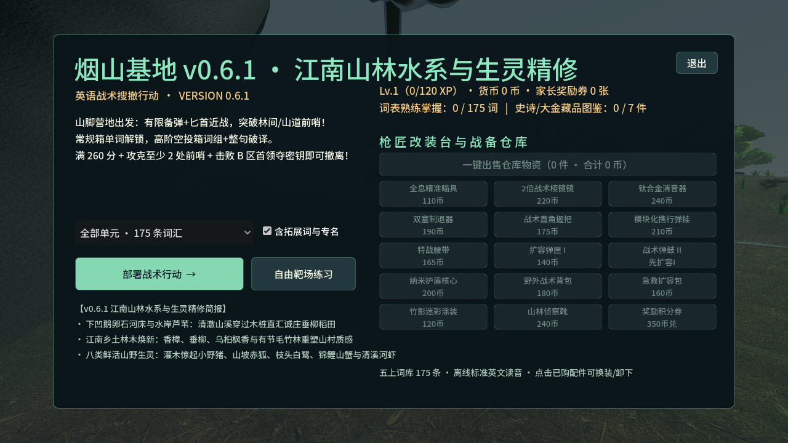
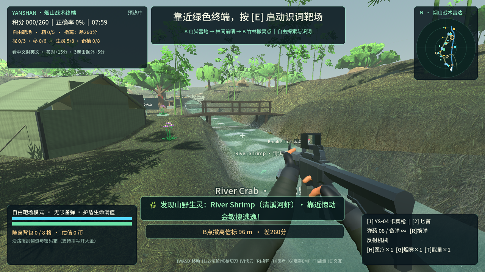
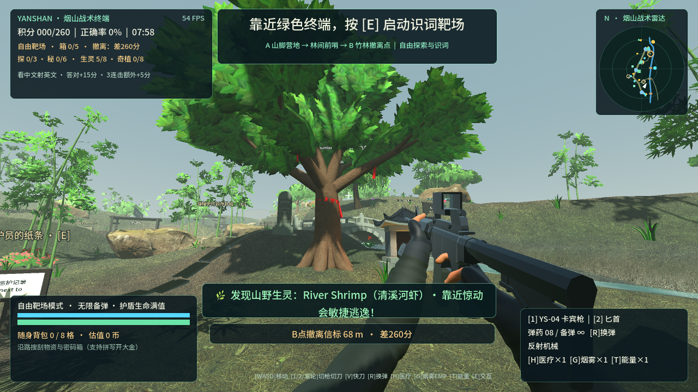
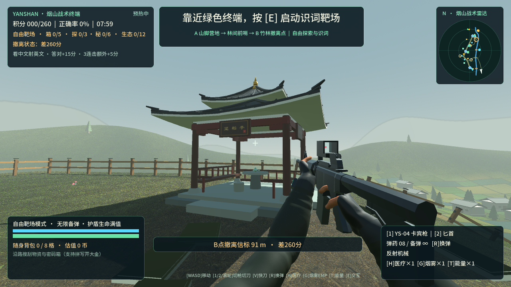
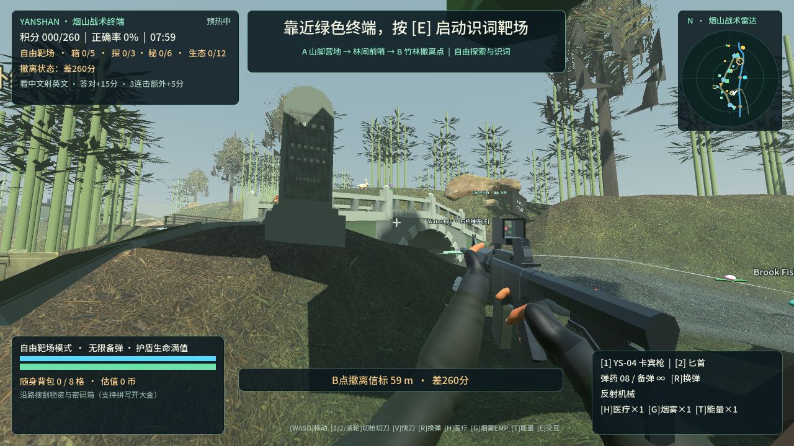

# 烟山行动 · Yanshan Force

> **结合家乡江南小村风貌与小学英语学习，利用 AI 协同开发的 3D 第一人称英语“搜打撤”游戏（Godot 4.7.2）**  
> An open-source 3D FPS English-learning extraction game inspired by a Jiangnan countryside village, built with AI collaboration to help primary school students master English vocabulary, phrases, and sentences.


---

## 项目初心 · Why We Built This

这个项目的起点很单纯：**想让正在读小学的孩子真正愿意学英语、反复记单词，而不只是枯燥抄写。**

因此我们把 **家乡江南小村与丘陵山野**（诚庄村外的成片稻田、白墙黑瓦农舍、蜿蜒竹林山溪）搬进了 3D 世界，结合孩子喜欢的第一人称战术“搜打撤”（搜刮 → 作战破译 → 撤离）玩法，借助 AI 工具在代码、3D 建模（Blender 4.5）、程序化贴图与音效合成上协同推进，做成了这套 **完全离线、轻量流畅（面向核显优化）、可自由扩展词库** 的学习游戏。

本项目代码以 **[MIT License](LICENSE)** 完全开源，美术/音频资产均遵循 `CC0` / `CC BY 4.0` / `OFL-1.1` / `MIT` 等开放协议，**欢迎各位家长、老师、学生和开发者任意 Fork、魔改、替换词库与二次开发！**

---

## 实机画面 · Screenshots (`v0.6.1`)

| 备战营地与枪匠改装台 | 南界山溪顺坡出流与村落垂柳 |
| :---: | :---: |
|  |  |

| 下切鹅卵石山溪与有节毛竹林 | 百年古樟、土地石龛与青石板古道 |
| :---: | :---: |
|  |  |

| 东岭「望稻亭」重檐飞檐 | 青石单孔拱桥与「烟山古境」界碑 |
| :---: | :---: |
|  |  |

---

## 核心特性 · Features

- **江南山林水系与八类生灵精修（`v0.6.1`）**：真实下切鹅卵石凹槽溪床（穿过木桩直汇山下垂柳水渠）、江南香樟/垂柳/乌桕/有节毛竹/映山红植物换代（移除远村欧式圣诞松），以及 **野兔、松鼠、灌木突袭小野猪、山坡赤狐、惊飞山鸟/白鹭、溪流锦鲤、溪石山蟹、弹尾清溪河虾** 共 8 类 52 只动态生灵。
- **“古今交织”江南人文地标（`v0.6.0`）**：飞檐重檐「望稻亭」（凭栏远眺诚庄梯田）、溪谷「青石单孔拱桥」与「烟山古境」界碑、四柱传统「烟山诗碑亭」（按 `[E]` 研读）、百年红绸古樟庇荫「土地石龛」及贴坡延展的青石板古道。
- **“搜打撤”阶梯式英语学习**：
  - **识词交战**：看中文释义 / 听英文语音，射击对应英文全息护盾得分（`+15` 分，3 连击额外 `+5` 分）；
  - **多级密码破译开箱**：常规箱单字拼写解锁；高阶密码箱（Tier 1/2/3）支持 **单词 → 词组 → 课本整句** 多关连破，支持缩写等价与英美拼写变体容错；
  - **离线语音与错词复盘**：内置 Windows 离线英文 TTS 朗读（`[Q]` / `[Tab]` 随时重听），局末自动汇总错词本（支持点击朗读），并记录每个词条的掌握度。
- **双武器近战、枪匠改装与首领战**：
  - Blender 4.5 雕刻级 39 骨骼第一人称战术手臂、**YS-04 卡宾枪 + 战术匕首**双武器切换；
  - 区分自由靶场（无限弹药，零惩罚练手）与战术行动（有限备弹补给 + 三线前哨 + B 区重装首领「铁甲词尊」）；
  - 营地商店含 15 项武器配件（全息/2倍棱镜/消音器/制退器/握把等）与便携装具，并预留线下“家长奖励积分券”机制。
- **立体跳格子与探索支线**：3 条物理验证的攀爬跑酷路线、双语战地线报与全图雷达扫描、小学五年级数学“图形平移/面积”近道机关、古诗石碑。

> 详细历史演进见 [CHANGELOG.md](CHANGELOG.md)。

---

## 接下来要去向何方 · Roadmap (`v0.6.x`)

我们正按 **“古今交织（方案 A）”** 持续深化烟山的江南人文与探索厚度：
- **`v0.6.0` 江南地标重塑**（✅ 已发布）：飞檐黛瓦「望稻亭」、单孔青石拱桥与古道界碑、传统「烟山诗碑亭」、百年古樟土地石龛与青石板古道；
- **`v0.6.1` 江南山林水系与生灵精修**（✅ 已发布）：下切鹅卵石活水溪道贯通出山、江南乡土乔木与有节毛竹林换代、8 类山林与溪涧生灵生态；
- **`v0.6.2` 秘境探索**：竹石交错的「迷踪竹石阵」与带残存矿物壁画、摩崖石刻及先人生活痕迹的纵深「烟霞古洞」；
- **`v0.6.3` 地方风物志**：《烟山风物志》非功利收藏手记与中英双语乡土风物卡片。

---

## 操作指南 · Controls

| 按键 | 功能 |
| :--- | :--- |
| `W / A / S / D` 或方向键 | 移动 |
| `Shift` / `Space` | 冲刺闪避 / 跳跃 |
| `1` / `2` / 鼠标滚轮 | 切换 YS-04 卡宾枪 / 战术匕首 |
| `鼠标左键` / `鼠标右键` | 射击或挥刀 / 开镜瞄准（含 2 倍棱镜缩放） |
| `V` / `R` | 一键快刀近战 / 换弹 |
| `Q` / `Tab` | 朗读当前英文发音 / 在密码终端重听词句 |
| `E` | 开箱破译 / 辨识奇花异草 / 线报 / 电台 / 撤离 |
| `H` / `G` / `T` | 应急医疗包 / 烟雾 EMP 手雷 / 肾上腺素能量饮 |
| `F6` / `F12` / `Esc` | 切换低负载阴影画质 / 截图 / 暂停菜单 |

---

## 运行与二次开发 · Quick Start & Modding

### 1. 从源码直接运行（无需联网）
1. 下载并安装 **Godot 4.7.2 Standard**（推荐 `GL Compatibility` 渲染方式，低配核显如 Vega 8 也能流畅运行）。
2. 克隆本仓库后，用 Godot 打开 [`game/project.godot`](game/project.godot)，点击运行即可进入游戏。
3. 局内存档保存在系统用户目录：`%APPDATA%\Godot\app_userdata\烟山基地 · 英语搜撤试玩\profile-v01.json`。

### 2. 零代码替换/扩展你的专属词库
想换成**人教版 / 译林版其他年级词汇、KET / PET 词库，或语文/科学单词卡**？
只需修改或替换以下 JSON 数据文件：
- 主词库：[`game/data/wordpacks/jiangsu-5a-2026.json`](game/data/wordpacks/jiangsu-5a-2026.json)
  每条词条遵循简洁结构（支持 `word` / `phrase` / `sentence`、`core` 核心词标记与 `aliases` 等价答案）。
- 探索与跨学科支线题库：[`game/data/exploration/grade5a.json`](game/data/exploration/grade5a.json)

### 3. 目录结构
```text
.
├── game/                   # Godot 4.7.2 游戏工程源码与资产（scripts / data / assets / tests）
├── tools/                  # Blender 4.5 建模脚本、SFX 合成、词库处理与自动化验收脚本
├── docs/                   # 版本规划、发布记录、校验报告与示范媒体
├── LICENSE                 # MIT 开源许可证
└── CHANGELOG.md            # 版本更新日志
```

### 4. 自动化回归验证
本机安装 Godot 4.7.2 后，可将运行时路径填入 `docs/runtime-local.json`（参考 [`docs/runtime-local.example.json`](docs/runtime-local.example.json)），运行：
```bash
python -X utf8 tools/check_slice.py --stage --ver 0.6.1 slice learning smoke navigation movement combat economy
```

---

## 开源协议与致谢 · License & Third-Party Credits

- 本项目源码采用 **[MIT License](LICENSE)** 开源发布，你可以自由使用、修改、分发和二次创作。
- 第三方模型、材质、字体与引擎模板均遵循 `MIT`、`CC0`、`CC BY 4.0`（含 Polyfork / Lucas Martinic 野生动物与草木基础网格）、`OFL-1.1` 等开放许可，完整溯源与原文许可证详见 [`game/THIRD_PARTY.txt`](game/THIRD_PARTY.txt) 与 [`game/licenses/`](game/licenses/)。
- 欢迎提 Issue 或 PR 分享你改造的新地图、新词库或教学玩法！
