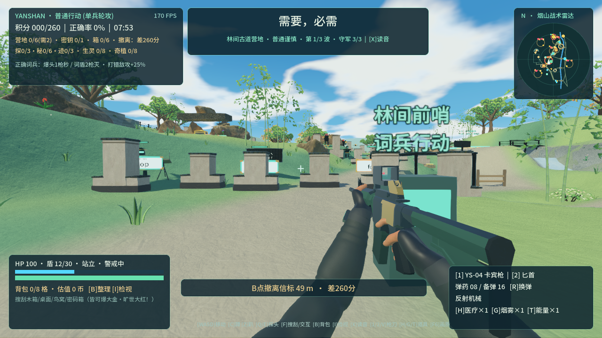

# 烟山基地 v0.6.6 独立评审报告

**评审方**　C 团队　｜　**被评版本**　G 团队 v0.6.6，Git 标签 `v0.6.6`，提交 `bdd0308`　｜　**日期**　2026 年 11 月 19 日

**评审意见：保留 v0.6.6 作为可玩基线，下一版优先验证一局能学会什么。** 烟山的地域题材、第一人称探索和离线教材词库值得保留。当前开发失衡发生在投入次序上。团队已经能细分一波敌人怎样行动、一件藏品怎样估值，却还无法可靠地回答“孩子昨天在烟山答错的词，今天能否自己认出、拼出”。同样，开发机已经有帧率数据，目标核显和孩子首次通关仍缺少可追溯记录。

| 评审项 | C 团队判断 | 下一版首先交付什么 |
|---|---|---|
| 项目方向 | 核心体验延续了初衷。最近几版持续扩展战斗、生态、藏品和天气，早期约定的短局验证被推后 | 保留一条从营地出发、读词、搜物、撤离的普通路线，交给目标学生独立走完 |
| 引擎与性能 | Godot 已经支撑当前规模。RX 6600 普通首营有帧率余量，成品启动至脚本首张交战画面却用了 34.87 秒。目标核显仍缺实测 | 统一启动与巡检，分段计时定位启动开销，再到 5700G / Vega 8 验收整局 |
| 游戏与学习 | 做对英语题能推动游戏，阅读还能帮助寻找物资。战斗胜负、箱子奖励和“掌握词条”目前不足以衡量独立回忆 | 先修失败局存档、掌握数和教材标注，再做次日无提示复测 |
| 美术设计 | 江南地标已经成立。晴朗青绿的方向有项目依据，近景材质、山谷纵深和战斗读词层级距原构想仍有差距 | 精修溪桥到首个营地这一段，在 720p 的标准档和核显档都验收读词 |

## 一、最初要验证什么，迭代把力量用在了哪里

11 月 7 日的设计讨论给出了一个很具体的尺度：先做山脚 A 至竹林 B 约 100 米，把 5–8 分钟的一局玩通，再决定是否扩大地图。画面设想是雨后渐晴、明亮而有重量感的江南山林，孩子能认路、看词、发现值得探索的物件。硬件目标为 Windows 单人离线、720p，Vega 8 的低负载目标是稳定 30 帧。README 也把“孩子愿意反复学英语”放在项目开头。[初版讨论说明](../planning/20261107-discussion-v1/阅读说明.txt) · [画面设计原稿](../planning/20261107-discussion-v1/01-画面参考与美术方向.html) · [早期试玩目标](../v0.4.0-试玩说明.txt) · [项目初心](../../README.md)

G 团队有三项值得保留的改动。普通与机密行动分开后，孩子可以选择较少的词盾。两波之间的空营与免战给玩家留出了整理物资的时间。密码箱和探索阅读界面会暂停游戏，孩子可以停下来思考。更贴近项目初心的是路牌旁的 `next to` 补给和靠英文方位线索找藏品：读懂一句话，能改变玩家接下来往哪里走。[战斗与休整](../../game/scripts/combat.gd) · [阅读与探索](../../game/scripts/exploration.gd) · [线索题库](../../game/data/exploration/grade5a.json) · [开箱与暂停](../../game/scripts/cipher_terminal.gd)

投入开始失衡的标志，是 v0.6.1 之后已经连续交付生态、身法、六营地波次、两处秘境、双行动、六档藏品、手部动作、云海和新敌人行为，普通行动仍沿用 480 秒倒计时。撤离要拿 260 分、攻克两处营地、取得 B 区首领密钥，再守信标 5 秒。每营三波，普通每波 3–4 名。若顺序攻完两营且不提前引战，四个波间窗口合计可达 120 秒，占局内八分钟的四分之一。玩家可以提前开战、换营活动，拼写窗口也会停表，因此必须另量孩子从点击开始到结算的**现实用时**。游戏中显示的剩余秒数回答不了这个问题。[版本记录](../../CHANGELOG.md) · [营地配置](../../game/scripts/layout.gd) · [撤离规则](../../game/scripts/rules.gd) · [行动计时](../../game/scripts/main.gd)

**资源取舍。** 保留普通行动、自由靶场和少数有记忆点的江南藏品。机密行动继续供熟练玩家选择。建议把新增敌人行为、更多稀有度、第二张大地图后移一次迭代，先看新手能否独立完成一局，以及第二天还记得什么。这项判断依据功能变化和验收缺口，仓库没有可用于核算各专业人时的工时表。

## 二、引擎与性能

**技术路线可以继续。** 36 米空间分块让成片植被分别参与可见性判断，地形高度使用缓存网格插值，小地图按 20 Hz 刷新。标准档已用到程序化天空、环境光遮蔽、体积雾和受控阴影。与之相对，主场景文件只有一个挂脚本的根节点，`slice_world.gd` 的 2,861 行同时生成地形、水体、植被、建筑和光照；`main.gd` 的 1,601 行还负责学习、存档与界面。美术人员想试改首个营地的构图，或程序员想单测错词记录，都要穿过大量无关逻辑。先把首个营地做成可单独打开的场景，把判分和学习记录从主流程中分出，其他区域随实际改动迁移。[主场景](../../game/main.tscn) · [场景生成与画质](../../game/scripts/slice_world.gd) · [地形查询](../../game/scripts/layout.gd) · [小地图](../../game/scripts/minimap.gd)

**三个发布入口已经分叉。** 根目录“开始烟山试玩”和“性能巡检”启动 v0.6.0。根目录“低负载启动”指向 v0.6.6，并显式选用 GL Compatibility。v0.6.6 包内的“低负载启动”和“性能巡检”仅传入低画质标志，默认仍走 Forward+。游戏中的 F6 修改阴影、雾效和 3D 分辨率。最直接的后果是两家拿到同名按钮，玩到的版本或渲染路径就可能不同。建议发布验收从玩家实际双击的每个入口开始，核对版本、渲染器、倍率和存档目录。[根目录普通入口](../../开始烟山试玩.cmd) · [根目录巡检](../../性能巡检.cmd) · [根目录低负载](../../低负载启动.cmd) · [包内低负载](../../playtest/windows-v0.6.6/低负载启动.cmd)

**历史帧率要按版本和路线使用。** W 报告引用的标准档 160.6–192.5 FPS 属于 v0.6.4 多视角记录，之后 v0.6.5 更换了主管线。v0.6.6 自带的成品巡检原始记录是 RX 6600、1280×720、61.782 秒、平均 99.92 FPS、P95 10.0 ms、最长一帧 36.80 ms。日志首行明确显示 Vulkan Forward+。JSON 的 `renderer` 是脚本写死的字符串；巡检调用 `start_action(false)`，走自由靶场，自动找正确靶、自动解箱。这是练习路线的有效回归，无法据此给普通行动、机密行动或 Vega 8 签收。[成品引擎日志](../v066-checks/packaged-engine.log) · [巡检脚本](../../game/scripts/performance_tour.gd) · [历史帧率所属版本](../../CHANGELOG.md)

**C 团队独立图形测量。** 使用同一 v0.6.6 PCK 和 Godot 4.7.2 控制台运行时，在 RX 6600、1280×720、关闭垂直同步下启动菜单，再进入普通行动首营。玩家位于固定观察点，词兵继续行动，不主动开火。每段预热 1.5 秒，再按实际墙钟连续采 5 秒相邻游戏帧间隔，P95 为第 95 百分位，数值越低越好。下表为每种启动方式各一次；随机兵力不同，F6 行是同一波稍后时刻。它衡量该视点的负载，整局和最繁忙场景仍要另测。[测量脚本](C团队复核/field_probe.gd) · [原始数值](C团队复核/复核数据.json)

| 普通首营场景 | 实际后端 | 实际 3D 倍率 | 同场词兵 | 平均 FPS | P95 帧间隔 | 最长一帧 |
|---|---|---:|---:|---:|---:|---:|
| 默认标准档 | Forward+ | 1.00 | 3 | 168.3 | 8.22 ms | 10.81 ms |
| 同一局按 F6 | Forward+ | 0.90 | 3 | 215.6 | 6.61 ms | 8.70 ms |
| 包内低负载启动参数 | Forward+ | 1.00 | 3 | 192.0 | 7.26 ms | 11.49 ms |
| 根目录低负载启动参数 | GL Compatibility | 1.00 | 4 | 207.7 | 6.66 ms | 9.10 ms |

这台独显在该场景有余量，两个启动低档都没有应用 F6 的 0.90 倍率。GL 启动日志还提示屏幕空间抗锯齿在该后端不受支持。三个带图形的运行均经正常初始化取得了英文语音 ID；本轮没有人工听辨发音。

**两处应优先核对的实现。** 启动参数在创建光照时读取，0.90 的渲染倍率则由 `set_low_quality()` 设置，两条入口没有共用同一套初始化。另有一个全屏描边着色器，用深度纹理还原距离时直接使用采样的 Z 值。Godot 4.7 文档区分了 Forward+ 与 Compatibility 的深度范围。当前公式只覆盖前者，GL 档的远近描边衰减需用同机位对拍核对。HUD 每帧更新多段文字也值得进性能分析器采样，现有证据不足以将它列为首要瓶颈。[分档和描边实现](../../game/scripts/slice_world.gd) · [HUD 更新](../../game/scripts/main.gd) · [Godot 4.7 深度重建说明](https://docs.godotengine.org/en/4.7/tutorials/shaders/advanced_postprocessing.html)

**起动等待比继续追高帧率更值得先查。** 三次控制台运行中，仅加载主场景并执行挂入场景树时的同步初始化就用了 37.55–38.78 秒。另一次直接启动分发的标准版 EXE，用内置普通交战预览从创建进程计到截图写完，实测 34.87 秒，进程按预期自动退出，退出码 0。这段时间包含自动开局、预览等待约 0.7 秒与写图，不能当成人工点击到首屏的精确读数。建议先给资源加载、地形、植被、生态及菜单可操作时刻分别打点，找出占时最多的一步，再选择烘焙静态场景或分段初始化。[主场景构建次序](../../game/scripts/main.gd) · [世界生成次序](../../game/scripts/slice_world.gd) · [独立测量数据](C团队复核/复核数据.json)

## 三、游戏与英语学习

**词库底子扎实，句库需要单独校对。** 用与词包记录 SHA-256 相同的五上英语教材重提书后词表，以英文、中文义、教材页码、核心标志四项逐条对照。162 条单元表与游戏非专名词条相符，175 条字母索引与整个词包相符。按游戏筛选口径，普通核心词条 119 条，另有 13 个专名也带 `core=true`。另行硬编码的 16 道密码箱句子采用不同 ID。按所标印刷页逐句查 PDF 文本层，统一大小写、空白和弯引号、保留句末标点，只有 2 道的题库字符串在标注页连续出现，且匹配处可以属于更长的课文语句。其余 14 道没有按此规则在标注页命中。建议这 16 道逐项标明“课文原句”“教材词组改编”或修正页码。第 17 页图上是 *It’s your turn now.*，题目少了 *now*；第 59 页图上是短语 *play the piano*，题库扩为 *I often play the piano.*；*We should warm up.* 在第 53 页命中，系统标第 44 页。改编句可以保留，学生按页回书时应找得到依据。[教材词表核对记录](../vocabulary-extraction.json) · [主词包](../../game/data/wordpacks/jiangsu-5a-2026.json) · [句库与界面页码](../../game/scripts/cipher_terminal.gd) · [五上英语教材原件](../../../江苏教材-五上教材电子版/26秋%20五上英语(江苏教材2026).pdf)

| 发现 | 对孩子或家长的实际影响 | 建议验收办法 |
|---|---|---|
| 失败局的错词没有在结算时写盘。C 用隔离存档在靶场答错一题后结束失败局，当局错词本可见，内存有该词，磁盘里没有 | 新手失败退出、下次重新打开时，恰好丢掉最需要复习的一批词。继续玩到成功或触发其他保存动作时，内存数据仍可能写回 | 在失败、超时和成功三种结算后重启；识词记录均在，失败局的背包收益按原规则清空 |
| “掌握 N/175”的分子遍历所有学习 ID，分母只算主词库。C 对句库 ID `s_u1_1` 调用两次现有拼写记分入口，主词包内无该 ID，掌握数仍加 1，同时记录为 `seen=0, correct=2` | 同一表达还可用主词包 ID 再记一次。两次同局成功也可达标，家长无法据此读出隔日保持 | 主词、教材改编句分别统计，按词包和稳定 ID 算分子分母；区分识别、独立拼写、提示后拼写和延迟回忆 |
| 波次从仍存活的词兵里随机选下一题。最后剩一个普通词兵时，只看场上还剩谁也能选对，正确仍进战斗记分和词条记录 | 能保持动作节奏，末位命中的教学信息却很少。错击还会增加来敌伤害，读词困难和操控困难混进同一个正确率 | 保留动作反馈，在学习记录中注明候选数、首次选择、是否提示；用有多个有效候选的首次回答估计识别 |
| 开箱前两次输入正确都按成功拼写记账。首错只给前缀提示，第二次答对仍可算完美；两错后看答案抄录可以继续游戏，第三次对不增加拼写成功 | 为初学者留下出路有价值。只看是否开箱，会把独立写出、提示后写出和照抄混在一起 | 让三种路径都能继续游戏，记录三种结果；对于提示或照抄的词，下一局安排一次无提示再答 |

以上两项数据问题分别通过失败结算和记分函数的定向复核得到。战斗末位选项、提示和计分条件由发布版本源码确认。[答题与结算](../../game/scripts/main.gd) · [掌握数与奖励](../../game/scripts/rules.gd) · [波次选词与记分](../../game/scripts/combat.gd) · [开箱判分](../../game/scripts/cipher_terminal.gd)

**游戏性应当保护的部分。** 找到藏品、权衡带走哪件物资、得到第二次尝试的机会，足以让英语有使用场景。现有撤离条件不要求完成拼写，露天物资和掉落包也提供绕过拼写的收益。建议让孩子读一条方位线索选择搜寻路线，在安全窗口回忆刚用过的词；不必给每个箱子再加题。错词已能在当局重现，历史错误也会影响新局部分种子词的权重。自由靶场“答到六题时抽一个错词”和主战波次“生成一组词后从存活者挑下一题”是两条不同路径。建议优先保证指定的薄弱词真的以题目出现，并测量隔日独立回忆，再决定是否投入复杂复习算法。[抽题与错词回访](../../game/scripts/main.gd) · [主战选词](../../game/scripts/combat.gd) · [场景拾取](../../game/scripts/world_loot.gd)

## 四、美术是否符合最初构想

两份参考各有用途。初稿确定了半写实、雨后放晴、路比林地略亮、文字底板平整的目标；项目后来的《太平村》对照图明确选择晴空、暖金积云与青绿梯田。采用明亮色调有依据。衡量成品应看三件事：第一眼能否认出江南，沿路能否辨别材料与空间，进入营地后能否顺畅读词。[初稿与配色](../planning/20261107-discussion-v1/01-画面参考与美术方向.html) · [项目保存的目标图与实机对照](../../美术参考与素材库/05_色彩采样与现状差距诊断/03_太平村云海梯田调色前后实机对比图.png)

| 镜头 | 已经做到 | 还差什么 |
|---|---|---|
| 石龛、溪桥与古树 | 白墙深檐、古树和桥连续入画，地标能帮助辨路。这是最接近“家乡能走进去”的一组 | 溪岸和草坡交界像裁出的色带；墙根、湿石、路肩可做局部磨损、苔痕与粗糙度过渡，给近景重量 |
| 南界远眺 | 柳树、村落、田块和远山都有可辨轮廓，晴空版本比旧样板更明亮 | 与目标图同看，前景黑色横栏和绿坡抢占画面，村落与梯田在淡雾中缩成小块，山峰明暗层级弱。先选定能看见谷底的行走视点，安排前景缺口、中景亮田和远山层叠 |
| 普通与机密交战 | 上方中文题干清楚，浅底深字的词盾延续了原始设计。普通行动减少同时要扫读的选项 | 普通行动“观看”图里，巨大的“林间前哨／词兵行动”比目标 *watch* 抢眼；长词组镜头还叠加线报大字、警告、光束和提示。让世界标牌在交战时淡出，稳定英文词盾的屏幕字号，并用侧角与最长词组验收 |
| 首屏菜单 | 三种模式、词库和版本可见，熟练玩家能迅速选择 | 新手同时面对改装价格、藏品、补丁说明和术语；旧文案仍写“5兵围剿”。首屏优先显示本次练习单元、普通行动和一句任务，补丁与详细改装放入二级入口 |

以上直接看过 v0.6.6 普通、机密、休整和菜单原图。溪桥与远眺采用 v0.6.5 的美术样片，图中帧率角标只代表截图瞬间。v0.6.6 的宣传镜头由脚本摆位，部分状态由脚本触发，适合判断构图和文字冲突；移动中是否读得清，要让孩子在实际机器上走一遍。[普通行动原图](../media/v066-cautious-cover-ai.png) · [机密行动原图](../screenshots/v066/05-confidential-bounding-overwatch.png) · [菜单原图](../screenshots/v066/01-menu-v066.png) · [溪桥原图](../media/v065-hui-shrine-creek.png) · [截图脚本](../../game/tests/capture_v066.gd)

下图是 C 团队直接加载 v0.6.6 发布包、进入普通首营后取得的 720p 画面。题干“需要，必需”清晰可见，此刻中间的词盾被垛口挡住，左侧和右侧只露出部分字母，背后地名却能完整辨认。词兵会继续移动，单帧尚不能确定遮挡持续多久；恰好说明为什么“175 个词都能放进标签”与“孩子当场读得清选项”需要分别验收。

同一观察点的 GL 低负载截图里，蓝天和背光坡面的颜色明显更深，四个词盾中的长词组也被垛口切开。两个档位需要分别做读词与色调验收；仅凭这两张画面无法把色差归因于某一种后处理效果。[GL 低负载同机位实测图](C团队复核/普通首营_GL低负载.png)

**美术投入顺序。** 锁定“溪桥望向村落”和“进入首个营地”两个游玩镜头。第一处把溪岸、桥脚、田埂和远山分出前中后景；第二处减少同时出现的文字，保证标准档、F6 档和 GL 入口都能读长词组。已有天空、雾、材质和批量植被足以做这轮改进。完成对拍和读词试玩后，再决定哪里值得增加模型或特效。

## 五、评审后的开发顺序

| 顺序 | 负责人建议 | 评审放行条件 |
|---|---|---|
| 1 · 先修会让评审失真的问题 | G 团队发布、学习规则负责人 | 三个入口标清版本与后端；巡检写实际渲染器和倍率；失败重启仍有学习记录；教材句来源逐条有据；句库不再抬高主词库掌握数 |
| 2 · 做一次可复现的设备验收 | G 团队性能负责人，C 团队复核 | 同一发布包在目标 5700G / Vega 8、720p，各跑冷启动、普通首营、B 区及撤离，机密另列。建议每档重复三次，分别记首屏时间、平均 FPS、P95、最长帧和掉帧场景。低负载 P95 以 33.3 ms 为 30 FPS 参照，首入卡顿单列 |
| 3 · 做一次家庭学习试玩 | 家长观察，目标学生独立操作 | 选同一单元、前测相近的两组词，交替用游戏和等时长的平时复习。记录现实局长、求助、放弃点、愿不愿再玩；当天与次日换序、脱离游戏测中译英和听写，一周后再抽查。分别列出原本就会、当场学会、次日仍会的词 |
| 4 · 用结果决定下一次投入 | 项目负责人、美术与玩法共同评议 | 孩子主要卡在找字，就先修视距、遮挡和 HUD；主要卡在操控，就缩短普通新手路线、保留机密行动难度；操作顺畅而隔日不会，就投入复习与再提取。局长按现实 5–8 分钟核对，首轮个案用于这名孩子的产品决策 |

W 团队指出的目标机缺测、真人保持率缺测和大脚本维护问题，C 团队同意。优先级上的差异是：在学习记录会丢失、统计对象混用、成品巡检会标错后端的情况下，先上复习模型、学习仪表盘或大规模重构，容易把问题带到下一版。先让记录可信，把一段路做好，再决定值得扩展什么。[W 团队原评审](评审意见_v0.6.6.md)

## 附录　版本和证据怎样复核

| 项目 | C 团队实际检查 | 结论适用范围 |
|---|---|---|
| 发布身份 | 分支 `main`、标签 `v0.6.6`、提交 `bdd0308`。重算 Windows EXE、PCK、分发 ZIP 的 SHA-256，三者均与发布清单一致 | 锁定本地交付物；根目录误指旧版的问题另列 |
| 发布包内容与功能 | 用本机 Godot 4.7.2 官方控制台运行时直接加载该 PCK。成品资源检查 17/17。另从同一标签加载九组项目测试脚本，学习 10、经济 32、启动与整局流程 33、战斗 56、移动 27、导航 13、物理 18、挑战 12、场景 165，合计 366/366，九组退出码均为零 | 无窗口集成检查；另行核对了词包哈希。家庭试玩、听觉体验和图形性能各需独立证据 |
| 目标机与真人记录 | `project-scope.json` 写了 Vega 8“已实测”和 `human_duration_validated=true`；早期验收文件写待测。本地 `docs/diagnostics` 下可解析的 26 份 JSON 均列 RX 6600。所核材料中未见可追溯的 Vega 8 运行记录、学生首局计时或隔日成绩 | 结论记为“待提供原始记录或补测”；无法据此断言团队在项目之外是否做过测试 |
| 教材与实物画面 | 验证教材哈希、重提两份书后索引、核对 16 句的标注页并目视抽查印刷第 17、59 页；查看首营、机密、休整、菜单和美术目标图，另取得普通首营独立截图 | 页码匹配依据正文文本层；看过的截图与版本逐项注明。实际移动读词和孩子动机仍需观察 |

功能复核可沿用项目的九个测试脚本，使用 `--headless --main-pack <发布PCK> --script <测试脚本绝对路径> -- --qa`。定向复核另附两段短脚本：[学习记分与失败存档](C团队复核/learning_probe.gd) 和 [图形、档位与帧间隔](C团队复核/field_probe.gd)。两者使用 `YS_C_TEST_PROFILE` 指向独立临时文件，学习脚本要求使用尚不存在的文件名，图形脚本同时保留一张同机位截图。图形测量保留正式启动时的英文语音检测路径，测试存档与玩家档案隔离。[发布哈希清单](../release-0.6.6.json) · [项目范围记录](../project-scope.json) · [早期验收原表](../final-verification-v0.4.0.json) · [回归脚本](../../game/tests/learning.gd)
