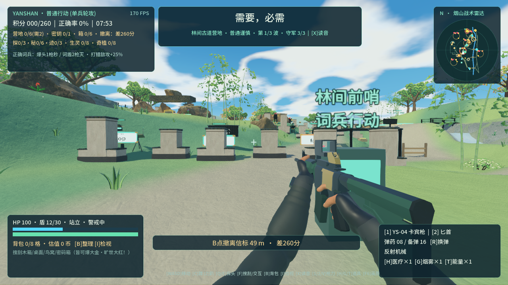
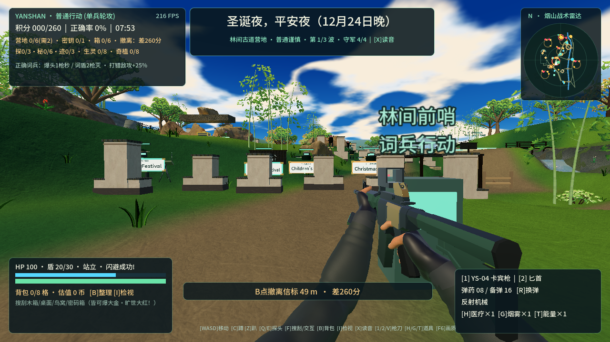
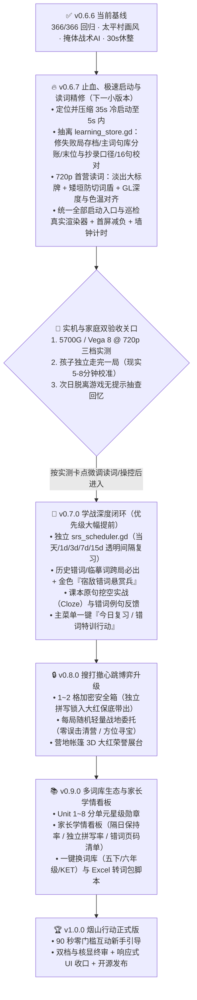

# G 团队评审答复与新版技术路线优化方案（回应 C 团队 & W 团队 `v0.6.6` 评审）

> [!IMPORTANT]
> **本轮性质：只读审阅、源码逐条复核、坦诚答复与路线图重校（零游戏代码改动）。**
> 我们以 **G 团队（主开发团队）** 身份，完整研读并逐项对照源码与实拍图，复核了 [C团队独立评审报告_v0.6.6.md](C团队独立评审报告_v0.6.6.md)、[评审意见_v0.6.6.md](评审意见_v0.6.6.md)（W 团队）以及 [复核数据.json](C团队复核/复核数据.json) 与两张 720p 实拍截图。
> 原则只有一条：**不护短、不盲从——实锤痛点 100% 认领并立为最高优，过度设计或事实偏差有理有据纠偏。**

---

## 一、总态与战略自省：两份评审到底戳中了哪几处要害？

两支独立团队从不同切入点给出了高度互补的诊断：**W 团队**从架构与教学法维度点破了宏观失衡，**C 团队**则用真实打包产物写探针、对拍 720p 实战图、逐页校对五上英语 PDF，抓出了 7 个我们此前完全盲区的实锤硬伤。

回看项目最初的初心——**“让正在读小学的孩子愿意反复玩、且第二天脱离游戏后真能自己认出和拼出英语单词；在 `5700G / Vega 8` 核显 `720p` 下流畅运行；单局现实节奏控制在 `5–8` 分钟”**——G 团队必须坦诚承认以下三处核心偏航风险：

1. **投入次序确实失衡（“好玩与美术跑太快，真学与实证欠账久”）**
   从 `v0.6.1` 到 `v0.6.6`，我们连续 6 个版本全力投入了生态、身法、六营波次、竹石阵与古洞、六阶大红摸金、青绿云海管线和掩体战术 AI，把原定在 `v0.6.5` 后的旧路线图（0.6.5 路线规划稿）继续排成了 **`v0.6.7 安全箱 → v0.6.8 战地委托 → v0.7.0 错词悬赏`**——这等于把“孩子到底记没记住、目标核显到底流不流畅、新手 5–8 分钟能不能打完一局”的验证又往后推了两版。
2. **教学与监控底层存在“数据失真”漏洞**
   我们在自豪于 `366/366` 回归全绿、`168–215 FPS` 时，没有发现：**失败局错词根本没写盘**、**16 道硬编码句子抬高了主词库 `N/175` 掌握数**、**巡检报告把 `Vulkan Forward+` 写死成了 `"gl_compatibility"`**、**根目录快捷方式还连着 6 个版本前的 `v0.6.0`**。在底座失真的情况下继续往上叠新玩法，只会放大隐性欠债。
3. **两个最致命的“实机盲区”被 C 团队一针见血揪出**
   - **35–38 秒冷启动主线程卡死**：我们一直盯局内帧率，完全漏测了从双击 `YanshanBase.exe` 到进入菜单的冷启动阻塞时间（对小学生来说，黑屏/卡住半分钟极易直接关掉游戏）；
   - **720p 正常走近视角下的词盾被垛口切碎**：我们在 `v0.6.6` 摆拍验收时避开了正前方遮挡角，而 C 团队不摆位直入首营的 720p 截图直接证明 `1.84m` 中央垛口把 3~4 面英文词盾切成了半截字母，且巨大的世界地名牌反客为主。

> [!TIP]
> **G 团队核心结论**：**保留 `v0.6.6` 作为可玩基线，但立即推翻旧版 `v0.6.7 安全箱 / v0.6.8 委托` 的排期！** 先用一个小而硬的 **`v0.6.7 止血、极速启动与读词精修版`** 把所有失真与卡顿清零 → 过一道真实的 **5700G/Vega 8 与孩子首局双验收关口** → 把原 `v0.7.0 学战闭环（间隔复习 + 跨局错词 + 原句实战）` **大幅提前到安全箱与委托之前**。

---

## 二、C 团队评审意见逐条查证与答复矩阵

| # | C 团队评审要点 | G 团队源码 / 实机查证事实 | 答复结论 | 后续落地计划 |
| :---: | :--- | :--- | :---: | :--- |
| **C1** | **失败局错词未写盘**：靶场/行动答错后失败或放弃退出，重启后该错词从磁盘消失 | **属实！** [main.gd](../../game/scripts/main.gd#L1514-L1520) 中 `_end_run(false)` 仅调用 `rules.abandon()`，**遗漏 `_save()`** | **✅ 完全采纳** | **`v0.6.7` P0**：无论撤离成功、超时、阵亡还是放弃，结算必保存学习记录与错词本；未撤离背包战利品仍按原搜打撤规则清空，补自动化回归测试 |
| **C2** | **“掌握 N/175”分子分母错位**：句库 ID（如 `s_u1_1`）不在 175 词包内却计入分子，且出现 `seen=0, correct=2` | **属实！** [rules.gd](../../game/scripts/rules.gd#L315-L329) 中 `record_word_spelled()` 与 `mastered_count()` 直接遍历整个 `profile.mastery`，混入了 [cipher_terminal.gd](../../game/scripts/cipher_terminal.gd#L9-L26) 的 16 个 `s_u*` ID | **✅ 完全采纳** | **`v0.6.7` P0**：词包主词（175）与句库（16）严格分账，按稳定 ID 校验归属后再算分子分母；拼写同步更新 `seen` 与独立/提示状态 |
| **C3** | **16 道硬编码句子页码与原文不符**（仅 2 道在标注页连续命中，如 `We should warm up.` 应在 p.53 非 p.44；p.17 实为 `It's your turn now.`） | **属实！** 核查 [cipher_terminal.gd](../../game/scripts/cipher_terminal.gd#L9-L26) 与 [复核数据.json](C团队复核/复核数据.json#L69-L166)，主词库 175 词 100% 准确，但 16 句为手写整理导致多处页码与词句偏移 | **✅ 完全采纳** | **`v0.6.7` P0**：对照五上 PDF 逐句重核并迁出到 JSON 数据文件，明确标注 `textbook_verbatim`（课文原句）与 `phrase_extension`（教材词组拓展）及精确印刷页码 |
| **C4** | **末位仅剩 1 兵免费猜对 + 拼写两错照抄混入统计**：动作节奏可保留，但学习统计必须剥离噪声 | **属实！** [combat.gd](../../game/scripts/combat.gd#L390-L413) 剩 1 兵时仍照常入账掌握度；[cipher_terminal.gd](../../game/scripts/cipher_terminal.gd#L561-L658) 前两次错/对边界较粗 | **✅ 完全采纳** | **`v0.6.7` P0**：保留末位击杀的爽快动作与两错防卡死兜底，但学习事件记录 `choice_count`（`<=1` 不推掌握度）与三级拼写结果（`independent` / `hinted` / `copied_scaffold`）；后两者自动入下局无提示复测 |
| **C5** | **35–38 秒冷启动主线程同步阻塞**（`scene_build_ms = 37.55–38.78s`，EXE 首图 `34.87s`） | **属实且已定位头号嫌疑！** 见下方第四节源码诊断：[slice_world.gd](../../game/scripts/slice_world.gd#L364-L398) `_ground()` 与 `_backdrop()` 产生了约 **50 万次未命中缓存的全量 `_land_height()` 计算** | **✅ 完全采纳** | **`v0.6.7` P0**：先加分段毫秒打点日志实测各模块耗时，再根治地形/外谷重复求值与同步重资源加载，目标冷启动至可操作菜单 **压进 `5 秒` 以内** |
| **C6** | **三个发布入口分叉 + `--low-quality` 未设 `0.90×` 缩放倍率** | **属实！** [开始烟山试玩.cmd](../../开始烟山试玩.cmd) 与 [性能巡检.cmd](../../性能巡检.cmd) 仍指向 `v0.6.0`；根目录与包内 [低负载启动.cmd](../../playtest/windows-v0.6.6/低负载启动.cmd) 后端不一致；[slice_world.gd](../../game/scripts/slice_world.gd#L183-L212) 漏调 `set_low_quality()` | **✅ 完全采纳** | **`v0.6.7` P0**：脚本统一生成全部根目录与包内启动入口并做发版校验；启动参数 `--low-quality` 统一调用 `set_low_quality(true)` 生效 `0.90×` |
| **C7** | **全屏描边深度重建未兼容 GL Compatibility + 实拍 GL 色差明显** | **属实！** [slice_world.gd](../../game/scripts/slice_world.gd#L264-L270) 直接把采样深度 `d` 当 Vulkan `[0..1]` 使用，未按 GL `[-1..1]` 做 `d * 2.0 - 1.0`；对比实拍图确认 GL 档天空与草坡明显偏暗/高饱和 | **✅ 完全采纳** | **`v0.6.7` P0**：为 `InkContourAndPaperOverlay` 注入后端统一变量区分深度重建公式，并针对 GL 回退档校准曝光/雾散射色温，双档同机位对拍验收 |
| **C8** | **`performance_tour.gd` 写死 `"renderer": "gl_compatibility"` 且只测靶场不测实战** | **属实！** [performance_tour.gd](../../game/scripts/performance_tour.gd#L122) 调 `start_action(false)`，[L187](../../game/scripts/performance_tour.gd#L187) 写死字符串 | **✅ 完全采纳** | **`v0.6.7` P0**：动态写入真实渲染后端、真实 3D 倍率与冷启动分段耗时；新增「普通行动首营 + B 区实战」性能采样段 |
| **C9** | **720p 实战读词障碍**：`1.84m` 垛口切碎词盾、巨大 `林间前哨/词兵行动` 世界标牌抢眼、首屏信息过载且残留 `"5兵围剿"` 旧文案 | **属实！** 核看 C 团队两张 720p 实拍图与 [challenge.gd](../../game/scripts/challenge.gd#L63)、[main.gd](../../game/scripts/main.gd#L754)，问题非常刺眼 | **✅ 完全采纳** | **`v0.6.7` P0**：交战时自动隐藏/淡出世界大标牌；重构营地矮垣高度与词盾防切挂位（用最长词组实机验收）；简化首屏菜单并修正旧文案 |
| **C10** | **现实用时失焦**：480s 局时遇 4 次 `15s+15s`（最多 120s）加开箱停表，无法反映孩子实际从开始到结束的 5–8 分钟 | **属实！** [main.gd](../../game/scripts/main.gd#L1244-L1248) 仅倒计 `time_left`，未统计真实墙钟耗时 | **✅ 完全采纳** | **`v0.6.7` P1**：存档与结算页新增独立 `wall_clock_seconds`；结合首轮孩子试玩结果决定是否增设「普通新手短局节奏」或允许清波后主动提前开战 |
| **C11** | **美术精修建议**：锁死“溪桥望向村落”与“进入首个营地”两镜头，补前景缺口、远山层级与溪岸过渡 | **方向正确，但需节制范围** | **⚖️ 部分采纳** | `v0.6.7` **全力优先解决“首营 720p 读词 + GL 色差”**；“溪桥/南界前景构图与岸线细节”按您此前“当前美术已可、重心转玩法与学习”的定调，排入后续轻量打磨而不拖慢止血与教学主线 |
| **C12** | **设备与家庭双验收 + `project-scope.json` 失实纠偏** | **属实！** [project-scope.json](../../docs/project-scope.json#L61-L81) 仍停留在 `v0.6.0` 且提前写了 Vega 8 已实测与 `human_duration_validated: true` | **✅ 完全采纳** | **`v0.6.7` 同步重写 `project-scope.json`** 为真实状态，并以 `v0.6.7` 正式包作为首轮 **5700G/Vega 8 实测 + 孩子首局 & 次日脱机复测** 的验收基线 |

---

## 三、W 团队评审意见逐条查证与答复矩阵

| # | W 团队评审要点 | G 团队深度评估与源码核查 | 答复结论 | 理由与处理方式 |
| :---: | :--- | :--- | :---: | :--- |
| **W1** | **核心诊断：工程/玩法投入高度与英语教学有效性深度不匹配**（README 承诺的「艾宾浩斯靶向巩固」未落地，`wrong_words` 每局清空，`mastery` 无衰减） | **完全切中要害！** 实查 [main.gd](../../game/scripts/main.gd#L879) 与 [README.md](../../README.md#L120)，我们确实把安全箱、委托和大量场景堆在了学习闭环之前 | **✅ 完全采纳** | 将 **学战闭环与间隔复习提前至 `v0.7.0`**（排在安全箱、随机委托之前） |
| **W2** | **P0 建议 #1：立刻上线完整 SRS（`last_reviewed / interval / ease / stability`，1d/2d/4d/7d/15d）与跨局错词本** | **方向对，但顺序与复杂度需校准** | **⚖️ 部分采纳（改顺序 + 轻量化）** | ① 采纳 C 团队指正：**必须先在 `v0.6.7` 修完“失败局丢记录 + 句库污染计数 + 假掌握噪声”**，绝不在脏数据上建 SRS；② 面向小学 175 词场景，采用**透明可解释的 5 级 Leitner 间隔梯度（当天/1d/3d/7d/15d）+ 强制出题配额**，比黑盒 SM-2 更适合家长看懂和孩子消化 |
| **W3** | **P0 建议 #2：拆分 `main.gd`(1601) / `slice_world.gd`(2861) 上帝类，引入信号总线** | **痛点真实，但“全面大重构”风险收益比差** | **⚖️ 部分采纳（绞杀者渐进拆分）** | `slice_world.gd` 已有 165 项通过断言且美术已基本定型，现阶段全面拆毁重来极易引入回归且零用户价值；**精准拆“要改的域”**：`v0.6.7` 抽离 `learning_store.gd`（学习记录/判分/落盘）+ 首营单场景入口；`v0.7.0` 抽离 `srs_scheduler.gd` 并用信号与 `main.gd` 解耦 |
| **W4** | **P0 建议 #3 & P1 #4/#6：补测 Vega 8 与真人教学有效率、建立帧率回归门禁、同步滞后文档（含 README `--ver 0.6.4`）** | **全部属实**；同时对 W 报告中两处数据口径作客观纠偏 | **✅ 完全采纳（附 2 处口径纠偏）** | 纠偏：① W 引用的 `160–192 FPS` 实为 `v0.6.4` GL 多视角数据，非 `v0.6.6` Forward+（C 团队实测 `v0.6.6` Forward+ 普通首营为 `168.3 FPS`，F6 为 `215.6 FPS`）；② W 误认打包巡检走 GL 是被我们脚本写死的字符串误导，将在 `v0.6.7` 彻底修正 |
| **W5** | **P1 建议 #5：修改拼写「2 错展示答案可照抄过关」机制** | **问题真实，但“完全不给答案”会卡死小学生** | **⚖️ 部分采纳（体验与统计解耦）** | **保留两错后展示参考并允许跟抄开箱**（避免小学生卡箱挫败），但拆分为 `copied_scaffold` 等级：**绝不涨掌握度、不给完美爆率加成，且强制下局无提示重考** |
| **W6** | **P2 建议：启用 MSAA 提画质、切换 Jolt 物理、`CPUParticles3D` 转 `GPUParticles3D`、引入动态分辨率自适应** | **经硬件与源码排查，这 4 项当前均属低 ROI 或有已知硬件雷区** | **❌ 当前阶段暂不采纳** | ① **MSAA**：`v0.6.4/v0.6.5` 已实测 AMD RDNA2（RX 6600）在 Vulkan Forward+ 开启 `MSAA + hint_depth_texture` 会触发深度解析伪影与额外带宽消耗，当前 FXAA 足够；② **Jolt**：当前物理仅为单胶囊体+静态盒体，无性能瓶颈且换引擎易引发蹲伏矮拱回归；③ **GPUParticles3D**：全图仅 110 个低速微尘且低档关闭，优化它省不到 `0.1ms`，远不如砍掉 **`35s` 冷启动**；④ **动态分辨率**：未实测 Vega 8 前属过早优化，且动态缩放会让 720p 词盾英文字体反复虚实跳变，直接伤害认词！ |
| **W7** | **P2 建议：`[input]` 映射与 UI 锚点重排、丰富错词例句反馈、多语音/aliases 数据化、学习仪表盘、`grade5a.json` 更名、`walking.ogg` 清理** | **合理但需按阶段排期，不抢 P0 资源** | **⚖️ 分期吸纳** | `walking.ogg` 告警与 README 命令随 `v0.6.7` 顺手清理；错词原句反馈与 aliases 扩充进 `v0.7.0`；学习趋势仪表盘进 `v0.9.0`；UI 响应式容器在重构菜单/看板时逐步替换，不专门停工重做 |

---

## 四、四大核心硬伤的源码级诊断与方案预览（供评审，暂未改代码）

### 4.1 35–38 秒冷启动阻塞：头号元凶已从源码锁定

C 团队实测显示，仅主场景同步初始化就耗时 **`37.55–38.78 秒`**（成品 EXE 至首张交战截图 `34.87 秒`）。经 G 团队源码排查，发现在进入游戏前存在一处极隐蔽的 **CPU 主线程算力黑洞**：

- [layout.gd](../../game/scripts/layout.gd#L186-L212) 的 `height(x, z)` **仅对整数坐标命中 `grid_height_cache`**；一旦传入小数坐标，就会退化执行全量 `_land_height()`（每次遍历 3 处哨所 + 20 处锚点 + **11 条折线共约 35 段道路** + 4 座溪桥）；
- 然而 [slice_world.gd](../../game/scripts/slice_world.gd#L364-L398) 的 `_ground()` 在生成 `156 × 120 = 18,720` 个地面方格时，对每个格子的 4 个未共享顶点都调用了 `_smooth_vis_normal(x, z)`，而其差分步长 `eps := 0.55` **100% 落在了小数坐标上**——导致单 `_ground()` 一个函数就在主线程触发了 **`18,720 × 16 ≈ 30 万次` 零缓存全量折线遍历**，加上 11 万次重复 `road_distance()`！
- 同理，[slice_world.gd](../../game/scripts/slice_world.gd#L1122-L1193) 的 `_backdrop()` 外围三环梯田也在未共享顶点的情况下调用了约 **20 万次** 零缓存 `land_edge_height()`。

**`v0.6.7` 治理路径（先测量、后开刀）**：
1. 先在 `main.gd:_ready()` 和 `slice_world.gd:setup()` 埋入精确毫秒分段打点，验证各环节真实耗时占比（同步核查 GLB 实例化、`ConvexPolygonShape3D` 碰撞体与字体加载是否也是次要大户）；
2. 将 `_ground()` 改为**一次性预建 `121 × 157` 共享顶点高度/路距/溪距二维数组**（从 ~30 万次计算降至 1.9 万次），法线直接用相邻数组索引 `O(1)` 中心差分，网格改为索引共享绘制（`ARRAY_INDEX`）；外环 `_backdrop()` 复用已缓存边界高度与顶点缓存；
3. **硬指标验收**：RX 6600 与目标 `5700G / Vega 8` 冷启动至主菜单可点击时间压缩至 **`< 5 秒`**。

### 4.2 720p 首营实战读词遮挡与 GL 低负载色差（实拍铁证）

以下为 C 团队在 `1280×720` 下无脚本摆位直接步入普通首营的真实画面对照：

````carousel

<!-- slide -->

````

**`v0.6.7` 根治设计**：
1. **交战清场视觉降噪**：触发营地交火后，自动隐藏或淡出该营地 [challenge.gd](../../game/scripts/challenge.gd#L23-L63) 的 `terminal_label`（`林间前哨 / 词兵行动`），让英文词盾成为视野唯一主角；
2. **彻底打破“掩体遮词盾悖论”**：
   - 将 [combat.gd](../../game/scripts/combat.gd#L246-L265) 营地前排正面的 `1.84m` 实心高垛口重构为 **`0.95m ~ 1.05m` 半身徽派青瓦矮垣**（词兵半蹲/掩护时保护躯干下半部，但**胸口及头顶全息英文词盾完整高出矮垣线，绝不被正前方垛口腰斩！**），高石柱仅保留在营地最外侧翼作为侧向闪身掩体；
   - 词盾挂点略微上移并优化宽度/字号自适应，验收时强制以词库最长词组（`Dragon Boat Festival`、`Christmas Eve`、`Children's Day`）在 `720p` 常规步入路线（标准档 / F6 档 / GL 档）三档全通！
3. **GL Compatibility 深度公式与色调对齐**：按 `RenderingServer.get_current_rendering_method()` 给 `InkContourAndPaperOverlay` 传递统一变量修正 OpenGL `[-1..1]` 深度重建，并针对 GL 回退档校准天空与地面亮度对比；同时在 5700G 实测后决定低负载默认走 `Forward+ + F6 (0.90×)` 还是 GL。

### 4.3 教学数据可信化（为 `v0.7.0` 间隔复习打好干净地基）

在 `v0.6.7` 中，我们从 `main.gd` / `rules.gd` 抽离出独立可单测的 **`learning_store.gd`**，建立清晰的数据契约：

| 指标维度 | `v0.6.6` 现状（有失真） | `v0.6.7` 纠偏后（真实可信） |
| :--- | :--- | :--- |
| **失败/放弃局持久化** | 未调用 `_save()`，错词重启即丢 | **所有结束路径必写盘**（学习档案独立于撤离战利品结算） |
| **掌握数分子 / 分母** | 遍历全量 `mastery`，句库 `s_u*` 混入 `N/175` | **严格按词包 ID 隔离**：`主词库掌握 N/175` 与 `教材句型掌握 M/16` 分开统计 |
| **有效识别判定** | 剩最后 1 名词兵点击也算掌握 +1 | 记录 `choice_count`；**仅 `choice_count >= 2` 的首次独立命中**计入有效识词 |
| **拼写结果分级** | 1~2 次都算成功，2 错照抄未区隔追踪 | 明确记为 **`independent`（首次独立）/ `hinted`（听音/提示后对）/ `copied`（看答案跟抄）**；孩子永不卡箱，但仅独立拼写推掌握，提示与跟抄自动入下局无提示复测 |
| **教材句型标注** | 16 句硬编码，仅 2 句与标页原文连续匹配 | 迁入 JSON，逐句对照五上 PDF 修正印刷页码并标明「课文原句 / 词组拓展」 |

### 4.4 现实用时 `5–8 分钟` 节奏对齐方案

C 团队敏锐指出：当前普通行动需攻克 2 营 × 3 波（4 个波间 `15s+15s` 休整窗最多 120s）+ 击败 B 区统领 + 260 分，叠加开箱停表后，**游戏内 480 秒并不等于孩子的现实体验时长**。
- **`v0.6.7` 先加客观量尺**：记录每局真实 `wall_clock_seconds`（从点开局到结算界面），并在结算与存档中留痕；同时在营地清波后的 `15s` 等待期内，保留“安全休整 + 走近/开火即可随时提前触发增援”的主动权（避免想快打的孩子干等）。
- **随后由真实孩子首局数据定调**：如果孩子实测一局现实用时明显超过 10 分钟，我们在普通行动顺势校准撤离门槛或波次（例如普通行动设为 2 波/营或可选“轻松 5 分钟快速行动”），机密行动继续保留 3 波硬核博弈。

---

## 五、优化后的新版技术路线图（`v0.6.7` → `v1.0.0`）

### 5.1 新旧路线对比：核心调整在哪里？

| 阶段 | 旧版路线图（`v0.6.5` 拟定） | **新版优化路线图（吸收 C/W 评审后）** | 调整核心理由 |
| :---: | :--- | :--- | :--- |
| **下一版 (`v0.6.7`)** | 加密安全箱 + 营地远距侦察 | **🔥 信任基线、极速启动与读词精修（止血版）** | 先砍掉 35s 启动卡顿、堵死失败丢错词/掌握数失真、修好 720p 词盾遮挡与统一入口，绝不带病加新系统 |
| **强制关口** | （无硬关口，顺推下一功能版） | **🚦 实机与家庭双验收（Vega 8 + 孩子首局 & 次日复测）** | 终结两个长期 `false` 遗留项，用真实核显帧率和孩子真实卡点决定后续投入权重 |
| **`v0.7.0`** | 原定在安全箱、委托之后再做错词悬赏 | **🧠 学战深度闭环（大幅提前！）**：5 级透明 SRS + 跨局宿敌错词必出 + 原句挖空实战 | 把“真学真记”拉回第一优先级，兑现项目初心与 README 核心承诺 |
| **`v0.8.0`** | 单元星级与大红展台 | **🔒 搜打撤心跳博弈升级**：加密安全箱 + 每局随机战地委托 + 营地大红荣誉展台 | 在学习闭环经实证跑通后，用安全箱与随机委托放大长期复玩爽感 |
| **`v0.9.0`** | 开源词库生态与家长周报 | **📚 多词库生态与家长学情看板**：Unit 1~8 星级闯关 + 隔日保持率周报 + 一键换词包工具 | 形成家长看得懂的教学回报 + 开源社区零门槛魔改生态 |
| **`v1.0.0`** | 正式版收官 | **🏆 烟山行动正式版**：90 秒互动新手教学 + 双档/核显终审 + 开源正式发布 | 完整产品化收口 |

### 5.2 新版路线全景图



---

## 六、待与您共同评审拍板的 4 个关键决策

在 G 团队动手改第一行代码前，请您确认以下 4 个方向性决策：

1. **路线次序调整确认**：是否批准暂停原定的 `安全箱 / 战地委托`，**立即进入 `v0.6.7 止血、极速启动与读词精修版`**，并在实机验收后将 **`v0.7.0 学战闭环（间隔复习 + 跨局宿敌错词）`** 提前到安全箱之前？
2. **双验收关口落地方式**：`v0.6.7` 打包完成后，是否由您协助安排一次 **真实 `5700G / Vega 8` 跑 `性能巡检.cmd`** 以及 **孩子独立试玩 1~2 局 + 次日脱机抽查**（我们会在包内提供傻瓜化一键记录工具，把现实用时和错词清单自动输出供家长对照）？
3. **营地矮垣与首营读词改造尺度**：为了根治 C 团队 720p 实拍中 `1.84m` 垛口切碎长词组的问题，我们计划将营地正面掩体调整为 **`0.95m ~ 1.05m` 半身青瓦矮垣（保护躯干、完整露出胸口/头顶词盾）+ 仅外侧保留高石柱，且交战时自动隐藏世界大标牌**。这个视觉与可读性的平衡您是否认可？
4. **首屏菜单瘦身方案**：是否同意将首屏简化为 **“今日单元选择 + 开始普通行动（主按钮）+ 机密/靶场（次按钮）+ 一句话目标”**，把 15 项枪匠改装、奇珍图鉴与版本日志收进右上/顶部清晰页签（老玩家一键切换，小学生进游戏不被满屏按钮劝退）？
5. **（可选）文档归档**：您是否希望在确认本方案后，将正式的《G 团队评审答复与新版路线图》同步落盘一份到 `docs/review-v066/` 文件夹中留存，方便 C / W 团队及后续版本溯源？
