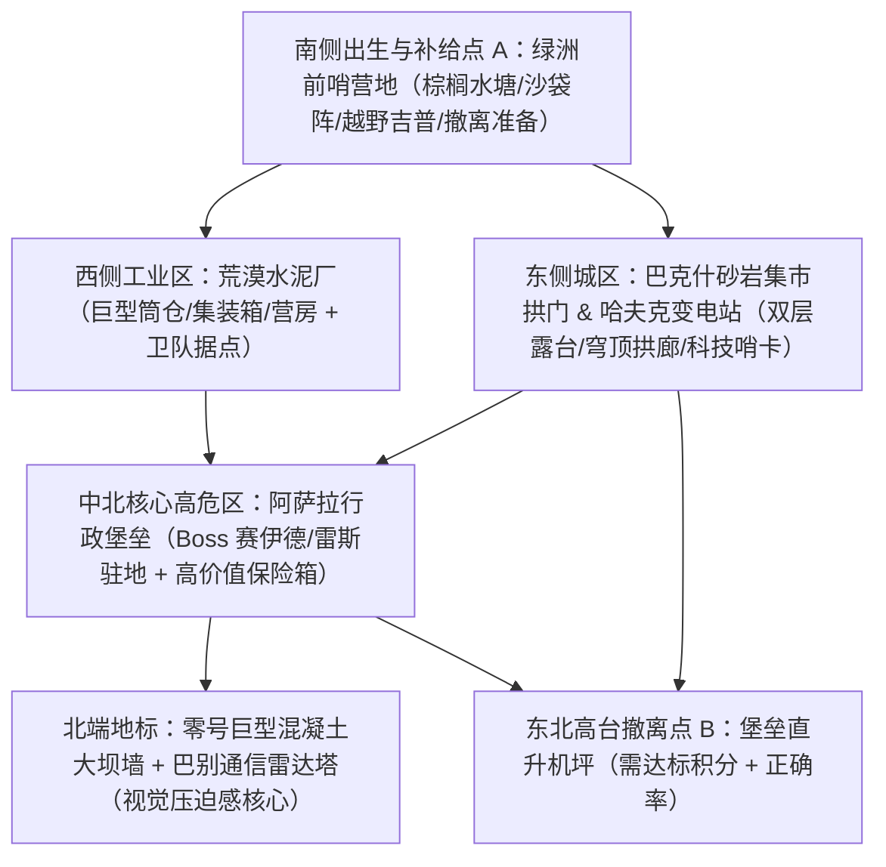

# 《烟山行动 · Yanshan Force》v0.9.x「阿萨拉堡垒」全版本规划方案

制定日期：2026-11-22  
基于基线：`v0.8.6`（`f9cf8d3`）  
目标版本区间：**`v0.9.0`（今晚先行试玩版） → `v0.9.1`（立体要塞与曼德尔砖攻坚） → `v0.9.2`（语音、双首领与完全体精修）**

---

## 一、核心定位与战略调整

为回应试玩期强烈期待，路线图紧急将 **`v0.9.x` 整段周期调整为全新沙漠特战地图「阿萨拉堡垒（Ahsarah Fortress）」专案**；原定多游侠名望招募切换与第二章古洞剧情顺延至 **`v0.10.0`**。

- **首要目标**：在 **`v0.9.0`（今晚版）** 即可完成「烟霞古洞机密石卫击败 → 一线天光后次元石壁解锁 → 主菜单切换进入阿萨拉堡垒（普通行动 + 机密行动完整可玩）」的端到端试玩体验。
- **美术与版权边界**：本项目为开源公益英语学习游戏（MIT），所有 3D 建筑/角色/藏品模型、贴图与音频均 **100% 自主制作（Blender 4.5 + 自研 PBR + 离线合成语音）**，绝不使用任何第三方商业游戏拆包资源；所有参考图仅存于本地忽略目录，在世界观与地图布局上向《三角洲行动》经典「阿萨拉」沙漠特战题材致敬并深度融合英语词汇搜撤玩法。

---

## 二、解锁链路设计（烟霞古洞「次元石壁」）

1. **物理坐标与视觉表现**：
   - 位于「烟霞古洞」内厅 **`一线天光 · 洞中寒潭`** 正后方的北侧天然岩壁上（`YanxiaAncientCave` 局部坐标约 `(-1.15, 0.03, -4.98)`，宽 `2.6m × 高 3.1m`，正好沐浴在一线天光光柱的映照下，走过寒潭旁石径与古茶灶即可无障碍交互）。
   - 未解锁态：石壁嵌有古老青铜裂隙纹路与微弱琥珀砂砾辉光，走近提示：`[F] 次元石壁（封印中 · 需在【机密行动】击败古洞循音石卫方可唤醒）`。
2. **触发与解锁条件**：
   - 玩家在 **烟山基地 · 机密行动** 中击败 **「古洞循音石卫」** 后，石壁立刻迸发青金—沙金双色次元裂隙光纹，浮现北非荒漠大坝的微光幻影并播放低沉空间共鸣音效。
   - 玩家靠近按 `[F]` 触发 **「次元铭文共鸣」**（随机拼写 1 个 175 词库高频英语口令词完成激活），激活成功即：
     - 永久写入存档 `profile["unlocked_maps"]`（含 `"yanshan"` 与 `"ahsarah"`）并立即 `save_profile()`；
     - 弹出金色解锁庆贺横幅：**`✦ 次元石壁开启！已永久解锁全新战场【阿萨拉堡垒】——下次返回营地即可切换出击！`**；
     - 同时解锁档案/图鉴新条目「阿萨拉次元裂隙简报」。
3. **战前地图选择入口（主菜单 / 营地出击面板）**：
   - 在现有「行动等级（普通行动 / 机密行动）」上方新增 **「行动战区」** 切换卡片：
     - **【烟山基地 · 江南幽谷】**（默认已解锁，保持 `v0.8.6` 100% 原汁原味）
     - **【阿萨拉堡垒 · 荒漠巨坝】**（未解锁时显示锁图标与线索提示：“在烟霞古洞【机密行动】击败循音石卫并开启一线天光后方的次元石壁”；解锁后高亮可选，直接支持 **普通行动** 与 **机密行动** 双模式出击！）

---

## 三、世界观融合、阵营角色与经典台词引入

将《三角洲行动》2035 年北非「阿萨拉」背景自然接入《烟山行动》的跨界英语搜撤框架：

### 1. 跨界接入设定
- 烟山「一线天光」下的先民次元石壁，连接着万里之外 2035 年的北非干旱古国 **阿萨拉（Ahsarah）**。
- 跨国科技巨头 **哈夫克集团（HAAVK）** 借修筑巨型水利枢纽 **「零号大坝」** 垄断水源、淹没本土村落，并暗中研发 **「曼德尔加密砖（MandelBrick）」**；本土武装 **阿萨拉卫队（Ahsarah Guard）** 奋起夺坝，国际应急组织 **G.T.I.** 向穿过次元石壁的烟山游侠发出紧急频段协作请求——突破词盾防线、搜集机密情报与失落珍宝并安全撤离！

### 2. 核心敌人阵营与双模式首领设计
| 模块 | 普通行动（阿萨拉堡垒） | 机密行动（阿萨拉堡垒） |
|---|---|---|
| **小队兵种** | **阿萨拉卫队游击兵**（沙漠卡其制服 + 赤红头巾，擅长掩体包抄与喊话 *“来！咱俩练练！”*）+ 东侧变电站少量 **哈夫克护卫**（纯白装甲 + 青蓝护目镜） | 精锐阿萨拉赤枭卫队 + 哈夫克高威胁无人机/电子战小队（更高词盾频次与精准压制） |
| **核心首领** | **「赤枭·赛伊德」（Captain Saeed）** — 驻守中北「阿萨拉行政堡垒」中庭： • 外观：暗红战术披风 + 护目镜 + 猎隼肩徽； • 机制：敏捷**战术翻滚位移**、**燃烧弹红圈封路**、三阶段多词盾拉锯（延续 `v0.8.6` 破盾单发弱点节奏，杜绝站桩扫射）； • 经典台词：*“父亲教导我，好的猎人懂得尊重猎物……但你，不配！”* / *“我看到你了，小耗子！”* / *“你掉进陷阱里了！”* | **「阿萨拉军阀·雷斯」（Warlord Reis）**（或 `v0.9.2` 升级为 **「赤枭·赛伊德 + 军阀·雷斯」双首领联动**）： • 外观：重甲战术风衣 + 墨镜 + 留声机伴随音效； • 机制：入场播放古典交响留声机提示、**重型霰弹逼近冲锋**、**双/三面公转重盾** + 卫队增援； • 经典台词：*“把留声机开大声点！没有交响乐的战场，简直粗俗不堪！”* / *“在阿萨拉，规矩由枪口和黄金说了算！”* |
| **撤离门槛与收益** | 撤离目标积分 `450` 分 / 正确率 `≥ 60%`（略高于烟山普通，鼓励先刷稳烟山再远征） | 撤离目标积分 `580` 分 / 正确率 `≥ 80%`，独占高概率掉落「非洲之心」「曼德尔加密砖」等阿萨拉限定大红/大金！ |

### 3. 阿萨拉限定藏品与探索线报
- **新增 6 件阿萨拉主题标志藏品**（无缝并入 108 → **114 件藏品库**，全部带 Blender 4.5 PBR 模型与 3D 展台展示）：
  1. **非洲之心（Heart of Africa）** — 传说级红品（巨型切割璀璨钻核，致敬最经典的大红传奇）
  2. **曼德尔加密砖（MandelBrick）** — 传说级红品（青金全息科技棱块）
  3. **阿萨拉王室金杯（Ahsarah Royal Chalice）** — 史诗级金品
  4. **军阀古董留声机（Reis's Gramophone）** — 史诗级金品
  5. **赤枭青铜猎徽（Fiery Owl Crest）** — 小金/紫品
  6. **巴克什鎏金油灯（Brakkesh Brass Lamp）** — 小金/紫品
- **6 处阿萨拉世界观探索点（随机 175 词拼写考题）**：
  - 「绿洲前哨 · G.T.I. 频段简报」、「水泥厂 · 哈夫克征水令」、「巴克什拱廊 · 老猎人手记」、「变电站 · 曼德尔砖研发日志」、「行政堡垒 · 赤枭通缉档案」、「大坝观景台 · 留声机残页」——读懂阿萨拉人物事迹的同时完成随机英语拼词，按全局金字塔爆率抽取补给与藏品！
- **人物小记扩充**：图鉴「👤 人物小记」新增 **赛伊德（赤枭）**、**雷斯（军阀）**、**阿萨拉卫队** 与 **哈夫克集团** 4 张新档案卡。

---

## 四、地图风格与布局设计（零号大坝 × 巴克什融合）

保持与《烟山行动》一致的 **阳光 3D 风格化无黑边 PBR 审美**，同时把配色与地形彻底切换为 **北非烈日荒漠峡谷**（清亮钴蓝天 + 暖沙金阳光 + 砂岩赤陶 + 混凝土巨坝冷灰），尺寸 **`160m × 200m`（32,000 m²）**，确保单局 8–12 分钟紧凑爽快且 `Vega 8` 稳跑 100+ FPS：

### 五大视觉与战术分区（直接对应参考图 `01`–`09`）
1. **南侧「A · 绿洲前哨」**（玩家出生点与安全缓冲）：浅池椰枣棕榈、沙袋掩体、橄榄绿军用弹药箱、战术吉普与 G.T.I. 便携电台，开局一眼北望即可看到远处压迫感十足的 **混凝土巨坝 + 砂岩要塞轮廓**！
2. **西侧「水泥厂工业区」**（复刻零号大坝经典西线）：3 座高耸混凝土筒仓、铁皮集装箱堆场、钢架连廊与营房，适合中近距卡点破盾。
3. **东侧「巴克什拱门集市 & 变电站」**（融合巴克什北非古堡 + 零号大坝东线）：暖赭黄夯土拱廊、锯齿垛口城墙、帆布遮阳棚阶梯露台，衔接铁丝网围栏与蓝白哈夫克变电站变压器群。
4. **中北「阿萨拉行政堡垒」**（全图主战场与 Boss 舞台）：宽阔砂岩—混凝土混合堡垒庭院，两侧双层城楼与中央穹顶大厅，内设 2 座高价值加密密码箱与首领巡逻舞台；北面紧贴横贯峡谷的 **42m 高巨型混凝土「零号大坝」主体与双雷达瞭望塔**。
5. **东北「B · 堡垒高台停机坪撤离点」**：设高地沙袋环阵与黄色 `H` 停机坪标线、烟雾信号柱；另保留西侧水泥厂外环绕行小道，确保至少 2 条高低/隐蔽撤离路线。
6. **360° 风格化荒漠峡谷远景**：沿用 `v0.8.6` 同款无黑边 3D 风格化全景工艺，生成专属 `horizon_ahsarah.png`（阳光红砂岩平顶高原 Mesa + 远方沙丘薄雾），彻底杜绝地图穿帮与割裂感。

---

## 五、多地图软件架构设计（确保烟山 0 回归 + 今晚快速落地）

当前 15 个脚本引用了 `Layout.*`，其中 `slice_world.gd`（132 处）仅服务于烟山。最干净、零风险的多地图解耦方案如下：

1. **地图布局代理层（`map_registry.gd` + `ahsarah_layout.gd`）**：
   - `layout.gd`（烟山）保持 **100% 静态常量与函数签名不变**，烟山既有 **559 项源码测试零破坏**；
   - 新增 `ahsarah_layout.gd`（实现与 `Layout` 完全同构的地形高度函数 `terrain_height(x,z)`、营地数组 `CAMPS`、撤离区、出生点、探索点、地图边界与小地图地标列表）；
   - `main.gd` 维护 `var active_map_id: String = "yanshan"` 与 `var active_layout`（按 `active_map_id` 指向 `Layout` 或 `AhsarahLayout`），其余共享系统（`combat.gd` / `minimap.gd` / `exploration.gd` / `world_loot.gd` / `wildlife.gd` / `player.gd` / `word_soldier.gd`）统一从 `game.active_layout` 读取坐标与高度。
2. **独立场景构建器（`ahsarah_world.gd`）**：
   - 与 `slice_world.gd` 并列，通过 `main.gd` 的 `load_map(map_id)` 动态切换重建世界节点（销毁旧 `landscape` 与当前局实体，实例化新 `SliceWorld` 或 `AhsarahWorld`，同步切换天空光影、远景贴图、地形碰撞、营地与小地图）。
   - 切换耗时预计 `< 0.8s`，且内存不叠加，稳守 Vega 8 帧率红线。

---

## 六、v0.9.x 三个小版本拆分与交付节奏

建议在 **`v0.9.x` 内拆为 3 个节奏清晰的小版本**，先确保今晚拿到爽快完整的试玩实包，再逐版打磨建筑立体度、曼德尔砖玩法与视听巅峰：

| 小版本 | 定位与目标时间 | 核心交付清单 |
|---|---|---|
| **`v0.9.0`** | **「阿萨拉堡垒 · 先行试玩版」**（**今晚交付实包**） | 1. **完整解锁闭环**：烟霞古洞一线天光后方「次元石壁」+ 机密石卫击杀门槛 + 英文口令唤醒 + 永久存档解锁 + 主菜单双战区/双模式选择； 2. **多地图架构 + `160×200m` 阿萨拉堡垒实景地图**：绿洲前哨、水泥厂筒仓、巴克什砂岩拱门集市、变电站、阿萨拉行政堡垒、北端巨型混凝土大坝与雷达塔、高台停机坪撤离点、专属 360° 沙漠峡谷远景与小地图； 3. **阵营敌人与双模式 Boss 首版**：阿萨拉卫队 & 哈夫克词兵小队、普通 Boss「赤枭·赛伊德」（翻滚/燃烧弹红圈/三阶多盾/经典台词）、机密 Boss「军阀·雷斯」（重盾/冲锋霰弹/交响留声机提示/经典台词）； 4. **阿萨拉内容接入**：6 处世界观随机拼词探索点、6 件阿萨拉主题新藏品（非洲之心/曼德尔砖等，总藏品 114 件）+ 4 张人物小记卡； 5. **全量验证与实包**：烟山 559 项回归 100% 通过 + 新增阿萨拉专项自动测试 + 双地图 GL 视觉截图巡检 + Windows 免安装实包。 |
| **`v0.9.1`** | **「立体堡垒、曼德尔砖破译与沙漠生态」**（第 2 阶段深挖） | 1. **Blender 4.5 精建阿萨拉核心建筑套件（`v091_ahsarah_fortress.glb`）**：可进入双层行政堡垒室内走廊/窗台卡点、地下大坝泄洪暗道捷径、精细巴克什圆顶澡堂拱廊与水泥厂可攀爬高台； 2. **核心特色事件「曼德尔砖破译站」**：从行政堡垒金库夺取曼德尔砖并护送至破译终端，边击退 2 波追兵边连续拼写 3 轮高频英语密文，成功必出高价值阿萨拉藏品； 3. **沙漠生灵与挂件**：新增沙漠耳廓狐、单峰驼剪影、荒漠猎隼、沙丘甲虫 4 种沙漠生态 + 3 款阿萨拉主题 3D 枪械挂件（非洲之心吊坠/赤枭羽徽/迷你曼德尔砖）与 6 项阿萨拉专属成就。 |
| **`v0.9.2`** | **「阵营语音、双首领决战与阿萨拉完全体」**（`v0.9` 封版） | 1. **阿萨拉专属声画系统**：赛伊德/雷斯/卫队中英双语风格化离线战斗语音 OGG、沙漠风声/留声机交响环境音、行政堡垒黄昏/烈日光影精调； 2. **机密独占「要塞戒严 · 双首领联动」**：机密行动开启主金库后触发警报，赛伊德与雷斯分阶段/协防迎战，打造全游戏最高含金量 Boss 战； 3. **巴克什皇家博物馆展厅分支** + 全图 Vega 8 四层实包性能压测与最终平衡定调，圆满收官 `v0.9.x`，接棒进入 `v0.10.0`。 |

---

## 七、开干前需共同拍板的 4 个细节

1. **今晚试玩解锁体验**：严格走「烟霞古洞机密击败循音石卫 → 开启一线天光后次元石壁」解锁主链路没问题；为了方便今晚直接验证与体验，**是否需要同时保留一个隐蔽的测试/家长快捷开关**（例如营地设置里的“允许体验测试地图”或命令行参数），还是希望**完全不留后门、必须先亲手打通机密古洞石卫再解锁**？
2. **普通 vs 机密 Boss 安排**：规划建议 **`v0.9.0` 普通模式 = 「赤枭·赛伊德」**、**机密模式 = 「军阀·雷斯」**（两人一轻盈翻滚纵火、一重甲霰弹配留声机，普通与机密体验差异拉满），到 `v0.9.2` 机密模式升级双首领联动——这个分配是否符合预期？（或者更希望普通与机密都以赛伊德为主、机密强化为“赤枭完全体”？）
3. **地图风格配比**：目前方案采用 **“零号大坝（北端巨型混凝土大坝 + 西侧水泥厂 + 东侧变电站）× 巴克什（中北与东侧暖阳北非砂岩古堡拱门）× 绿洲前哨”** 的复合要塞风格（已绘制 `08`、`09` 概念图），你更偏爱当前这种 **砂岩古堡 + 混凝土巨坝混搭**，还是希望更偏向纯粹的现代混凝土军事基地？
4. **阿萨拉限定大红「非洲之心 / 曼德尔砖」爆率**：建议严格遵守 `v0.8.6` 金字塔爆率哲学——**普通模式极低概率惊喜掉落、机密模式首领/核心密码箱适度提高掉落概率**，避免一局刷满失去稀有成就感，是否认可？

---

## 八、四项拍板落实结果与 `v0.9.0`–`v0.9.1` 交付状态

以上 4 项均已确认拍板并于 `v0.9.0`–`v0.9.1` 全部落地闭环：
1. **双轨解锁**：烟霞古洞机密石卫击败 → 一线天光后「次元石壁」拼词永久解锁 + `⚙ 设置` 内提供家长/试玩快捷解锁勾选开关；
2. **双模式双首领**：普通行动「赤枭·赛伊德」 + 机密行动「阿萨拉军阀·雷斯」；
3. **风格配比**：100% Blender 4.5 自研阳光 3D 风格化 PBR「零号大坝 × 巴克什砂岩古堡 × 绿洲前哨」复合荒漠要塞（`v0.9.1` 进一步完成双层可登行政堡垒、68m 地下泄洪暗道、巴克什穹顶浴场、水泥厂 +4.2m 高架钢桥、曼德尔砖 3 轮破译攻坚站、4 种 28 只骨架沙漠生灵、341 条离线语音与 30 成就 / 16 款 3D 挂件，详见 `docs/v0.9.1-验收记录.md`）；
4. **严格金字塔爆率**：严格沿用 `v0.8.6` 全局 7 级金字塔爆率曲线（含 `v0.9.1` `mandel_decode` 校准表），仅在阿萨拉战区对高阶命中做区域藏品权重倾斜（详见 `docs/v0.9.0-验收记录.md` 与 `docs/v0.9.1-验收记录.md`）。
