# 烟山行动 · Yanshan Force 游戏发展路线图（近期规划与中长期路线）

更新日期：2026-11-21  
当前主线版本：**`v0.8.4`**（已通过试玩确认并提交推送至 `origin/main`，当前启动 **`v0.8.5`** 大烟山 3 倍扩张与两项手感精修）

---

## 一、总览时间线

```mermaid
flowchart LR
    V072["v0.7.2 已推送<br/>SRS + 279离线美式女声<br/>+ 32件PBR藏品"]
    V080["v0.8.0 已推送<br/>64件藏品/7级稀有度<br/>仓库锁存/安全箱/3D展台"]
    V081["v0.8.1 已推送<br/>远距狙词/防盲蒙/3错狂暴<br/>正确率撤离/望稻亭高台"]
    V082["v0.8.2 & dev1 & dev2 已推送<br/>雾隐帮/双特色Boss/单人序章<br/>严律复习/舒适设置/数值平衡"]
    V083["v0.8.3 已推送<br/>游侠「少羽」[V]天生神力<br/>陈向导名望委托/人物小记<br/>石卫锁洞 + 开镜防骚扰"]
    V084["v0.8.4 已推送（当前基线）<br/>挂件左侧外显/石卫双臂护核<br/>全物资选择性搜刮面板"]
    V085["v0.8.5（推进中）<br/>大烟山面积3倍扩张(180×240m)<br/>云顶演武坛/石卫潜行/挂件后移"]
    V086["v0.8.6<br/>机密玄铁词尊史诗重做<br/>鸣潮风多招/两轮旋转词盾<br/>终极技「天地万象」"]
    V090["v0.9.0<br/>多游侠名望招募切换<br/>第二章古洞剧情/教学闭环"]
    V100["v1.0.0<br/>诚庄村河岗 / 鲸塘中心小学<br/>跨学期词库完整版"]

    V072 --> V080 --> V081 --> V082 --> V083 --> V084 --> V085 --> V086 --> V090 --> V100
```

---

## 二、已完成里程碑回顾

| 版本 | 核心定位 | 关键交付成果 | 状态 |
|---|---|---|---|
| `v0.6.x` | 烟山 3D 世界与战术搜撤雏形 | 江南溪谷/竹林/梯田/迷踪竹石阵/烟霞古洞、掩体战术词兵 AI、密码箱放大镜开箱、双手近战刀 | 已推送 |
| `v0.7.0–v0.7.2` | 离线语音与藏品美术大翻新 | 5 级间隔复习 SRS、175 词 + 16 句 + 藏品离线美式自然女声、首批 32 件 Blender 4.5 PBR 建模与 2D 影棚图标 | 已推送 (`v0.7.2`) |
| `v0.8.0` | 摸金经济重塑与 64 件博物藏品 | 7 级稀有度（增设小金）、64 件独立 3D 藏品、营地收藏库（单件售/锁存/3D 展台）、2 格加密安全箱、盲盒去剧透与 14 处隐蔽秘藏 | 已推送 (`v0.8.0`) |
| `v0.8.1` | 狙词战术、作答纪律与实景材质 | 远距瞄准狙词、错题锁分强制换新题 + 倒计时、3 连错 12s 狂暴围剿、普通 60%/机密 80% 撤离正确率门槛、自由靶场纯训练化、望稻亭高台与 1024 高清山石/青石板 | 已推送 (`v0.8.1`) |
| `v0.8.2–v0.8.2_dev2` | 「雾隐帮」双 Boss、序章与平衡精修 | 雾隐帮定名、古洞循音石卫与机密玄铁词尊、可编辑单人序章（`prologue_chapter.tscn`）、严律每日复习、舒适设置、24 项成就与 13 款挂件、匕首 5/10 刀平衡、定量弹药与 B 区首领红圈轰炸、复测光标常驻、换词自动朗读、林间前哨靶牌去穿坡 | 已推送 (`v0.8.2_dev2`) |
| `v0.8.3` | 游侠「少羽」`[V]` 技能、名望委托与双项实机热修 | 可扩展游侠体系（`rangers.gd`）、默认游侠「少羽」`[V]`「天生神力」（震倒词兵 1.5s / 30s CD / 右下角专属 HUD、`[V]` 与匕首解耦）、营地联络员「陈向导」随机名望委托、图鉴第 3 页签「👤 人物小记」（8 张角色卡）、循音石卫严锁烟霞古洞 + 3D 血条/弱点重做、远距开镜狙词收紧至 3 倍仇恨（~46–48m）+ 严格右键开镜 + 地形遮挡 + 1.2s 防抖 | 已推送 (`v0.8.3`) |
| `v0.8.4` | 挂件左侧外显、石卫双臂护核博弈与全物资选择性搜刮 | 13 款 3D 挂件左侧黄铜悬臂 `1.45×` 外显（腰射/ADS 清晰无遮挡）；「古洞循音石卫」Blender 4.5 分件重塑双臂巨盾与 `0.30m` 蓝核、受击即 X 护核偏折、追击/破防露核及实体掉落包；全物资 100% 统一双栏选择性确认拾取面板（入包/存安全箱/蓝品筛选/现场丢弃腾位/未拾留箱）；模态期间成就横幅自动避让 | 已推送 (`v0.8.4`) |

---

## 三、近期三版本攻坚路线（`v0.8.4` → `v0.8.5` → `v0.8.6`）

### 阶段 1：`v0.8.4` · 挂件外显、循音石卫双臂护核博弈与全物资勾选搜刮（✅ 已推送）
1. **枪械挂件左侧外显重构（`weapon.gd`）**：将挂件挂耳移至步枪朝向镜头的左前外侧导轨并适度放大（`~1.45×`），确保 13 款成就挂件在腰射、跑动、开镜时均醒目悬垂不被枪体遮挡。
2. **「古洞循音石卫」双臂护核与蓝核缩小重塑（Blender 4.5 + `cave_warden.gd`）**：
   - 将石卫模型拆件重导为可独立驱动的双臂+主体结构，胸口发光蓝核由 `0.56m` 缩小至更精致的 **`0.30m`**；
   - **受击即护核**：石卫中枪后双臂立刻合拢交叉护住胸前能量球（正面弹刀/极低擦伤）；
   - **追击/破防才露核**：唯有石卫主动大步追击逼近，或被 `[G]` 烟雾/EMP 致盲、少羽 `[V]` 天生神力震晕、累计失衡时，双臂才张开暴露胸口蓝核，形成高含金量的攻防拉扯博弈。
3. **全物资选择性搜刮面板（`loot_container_ui.gd`）**：
   - 密码箱、补给箱、小队/首领掉落包、隐蔽秘藏/鸟巢/茶灶以及**地面单件散落物资**，均统一弹出双栏确认拾取面板，不再自动全塞背包；
   - 支持逐件点选拾取、直存安全箱、一键拿蓝品及以上、右侧背包整理丢弃腾位，未拾取物品保留原处可回头再拿。

### 阶段 2：`v0.8.5` · 「大烟山」面积 3 倍扩张、营地空间疏散、地标美术升级与 `v0.8.4` 两项手感精修
1. **烟山地图面积扩大至 3 倍（约 `180m × 240m ≈ 43,200 m²`，长宽各约 `×1.73`）**：
   - 6 座雾隐帮营地间距由 `25–42m` 拉开至舒朗的 **`58–95m`**，彻底消除营地拥挤与视野串联，同时保持 8–12 分钟单局紧凑的徒步搜撤节奏与 `Vega 8 / GL Compatibility` 流畅帧率；
   - **烟霞古洞**迁入西侧独立竹林幽谷（距最近营地 `≥60m`）；
   - 最北端高台开辟 **直径 `36–40m` 的开阔「云顶青石演武坛」**，为下一版玄铁词尊与「天地万象」大招提供宏大舞台。
2. **Blender 4.5 + 开源 CC0 地标与地形升级**：补充古石拱桥、茶岭凉亭、摩崖石碑、云顶演武坛盘龙石柱阵等高辨识度江南地标，全链同步小地图比例尺、战利品点位、单人序章、性能巡检机位与全量回归测试。
3. **同步精修 `v0.8.4` 试玩反馈两项**：
   - **古洞循音石卫受击与潜行机制重构（`cave_warden.gd`）**：彻底取消“击中核心/累计伤害触发晕厥”设定；改为击中核心瞬间**立刻双臂护核 + 施展声波攻击**，随后玩家进入潜行静默（不发声）**`1.5 秒`**后石卫即放弃搜索并再度放开双臂，形成“一击破核 → 护核声波反击 → 潜行静默 1.5s 脱搜 → 再次开臂狙核”的真听声潜行博弈循环；
   - **枪械 3D 挂件后移至瞄准镜侧边下方枪体（`weapon.gd`）**：将挂件挂耳后移到瞄准镜左侧下方上机匣位置（夹在前后双手握持区之间），彻底消除任何动作下与前后手的穿模接触。

### 阶段 3：`v0.8.6` · 机密 Boss「玄铁词尊」史诗重做 & 终极技「天地万象」
1. **彻底根治开镜提前掉落 Bug + 近身天降震倒演出**：
   - 开局完全隐藏于高空、禁远距开镜锁定与射线触发；玩家踏入演武坛领地（`≤22m`）才触发雷云光柱天降砸地，**冲击波将全场地面生物震倒 1.0 秒**。
2. **Blender 4.5 多关节重塑 + 动作游戏风格多招式**：
   - 关节化重做玄铁词尊（可动双臂巨刃、悬浮鎏金词轮），告别原地站桩，实装瞬步逼近、红环预警旋风双刃斩、直线预警裂地剑气、浮游法轮弹幕（全招带清晰蓄力指示与闪避解法）。
3. **两轮生命值 + 动态旋转词盾**：
   - **第一轮**：击破 5 块英文词盾，**连续击中前 2 词后，剩余 3 词脱离身体开始绕身公转**；
   - **第二轮**：**10 秒内**按准确顺序击破 **3 个高速旋转词盾**即可破招斩杀。
4. **终极技「天地万象」（倒悬镜像烟山压顶）**：
   - 若第二轮 10 秒内未能按序击破 3 个旋转词，天穹裂开——从高空召唤一座基于烟山地形高度场打造的**倒悬镜像烟山**（Blender 4.5 轻量化巨构 + 墨云金阵特效），与脚下烟山上下合拢将玩家挤压在中间，**一次性将玩家护盾清零、血量压至恰好 10%（10 HP）**，随后留出回血喘息窗再循环决战。

---

## 四、中长期规划（`v0.9.0` → `v1.0.0`）

### `v0.9.0` · 多游侠名望招募切换、第二章剧情与教学闭环
- 基于 `v0.8.3` 游侠体系与「烟山名望」，实装林听风（侦察鹰眼）、苏青禾（急救脉冲）、竹影（潜行静音疾行）招募与战前切换；
- 第二章「烟霞古洞深处」8–10 分钟独立剧情任务；
- `Unit 1–8` 分单元星级掌握地图、家长本地学习周报导出、零代码一键换词包工具；
- 完成 `Ryzen 7 5700G / Radeon Vega 8` 实机巡检与 3–5 位新玩家序章独立试玩实证回填。

### `v1.0.0` · 江南多地图与跨学期完整版
- 扩展新地图：**「诚庄村河岗」**（水乡古桥与河埠巷战）与 **「鲸塘中心小学」**（校园教室/操场情景英语行动）；
- 完善多本地档案切换与完整开源教学游戏模板文档。
