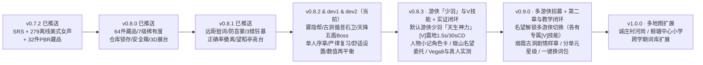

# 烟山行动 · Yanshan Force 游戏发展路线图（近期规划与中长期路线）

更新日期：2026-11-21  
当前主线版本：**`v0.8.2_dev2`**（基于 `v0.8.1 / 51a3bc5` 本地持续打磨，待实玩确认后统一提交并推送远程）

---

## 一、总览时间线

---

## 二、已完成里程碑回顾

| 版本 | 核心定位 | 关键交付成果 | 状态 |
|---|---|---|---|
| `v0.6.x` | 烟山 3D 世界与战术搜撤雏形 | 江南溪谷/竹林/梯田/迷踪竹石阵/烟霞古洞、掩体战术词兵 AI、密码箱放大镜开箱、双手近战刀 | 已推送 |
| `v0.7.0–v0.7.2` | 离线语音与藏品美术大翻新 | 5 级间隔复习 SRS、175 词 + 16 句 + 藏品离线美式自然女声、首批 32 件 Blender 4.5 PBR 建模与 2D 影棚图标 | 已推送 (`v0.7.2`) |
| `v0.8.0` | 摸金经济重塑与 64 件博物藏品 | 7 级稀有度（增设小金）、64 件独立 3D 藏品、营地收藏库（单件售/锁存/3D 展台）、2 格加密安全箱、盲盒去剧透与 14 处隐蔽秘藏 | 已推送 (`v0.8.0`) |
| `v0.8.1` | 狙词战术、作答纪律与实景材质 | 98m 远距瞄准狙词、错题锁分强制换新题 + 倒计时、3 连错 12s 狂暴围剿、普通 60%/机密 80% 撤离正确率门槛、自由靶场纯训练化、望稻亭高台与 1024 高清山石/青石板 | 已推送 (`v0.8.1`) |
| `v0.8.2` | 「雾隐帮」定名与双特色 Boss | 统一命名「雾隐帮」、烟霞古洞听声 Boss「古洞循音石卫」、机密天降 4m 五盾 Boss「雾隐机关王·玄铁词尊」、枪械刚性挂载与 5.56mm 真实枪声、24 项趣味成就 + 13 款物理 3D 枪械挂件、开局今日必做复习门禁、望稻亭零闪烁/古洞真天窗/实心青绿远山等 12 项精修 | 本地已完成 |
| `v0.8.2_dev1` | 响应 C 团队综合评审 | 可编辑单人序章「烟山初行：望稻亭失联信标」（`prologue_chapter.tscn`）、跨单元严格今日复习防绕过 + 看答案重输记「练习完成」防虚计、实战营地热身零污染与五盾精确候选数、主菜单/暂停「⚙ 舒适与设置」（减震动/独立音量/灵敏度）、文物双层考据卡、三段式硬件巡检修复、安全存档 v3 自动备份、279 OGG + 34 WAV 全量解码验收 | 本地已完成 |

---

## 三、当前版本：`v0.8.2_dev2`（战斗/弹药/近战/古洞数值再平衡与实玩细节精修）

聚焦 2026-11-21 `v0.8.2_dev1` 真人试玩发现的 6 项核心平衡与手感问题：

1. **近战匕首高风险再平衡**：普通模式需 **5 刀**、机密模式需 **10 刀** 击杀词兵；近身贴脸肉搏会触发敌兵反击冲撞/近距反击，砍错 0 伤害且立刻挨反击并叠错词惩罚；仅在近战击杀完成时回补少量备弹。
2. **定量弹药-积分经济体系重塑 + 强威胁古洞石卫 & 普通 Boss**：
   - 基于撤离目标（260 分 ≈ 2 营地 + 首领 ≈ 35–50 发精准射击）严控全图弹药总投放：初始备弹减半（普通 16/24 发、机密 12/18 发，设上限防囤弹）、精准击杀仅返 +2/+1 发、清波返 +4/+3 发；野外地面弹药箱普通保留 6 处（+8 发、90s 刷新冷却）、机密仅留 4 处（+6 发、150s 刷新冷却），杜绝无脑乱扫刷分。
   - **古洞循音石卫全面强化**：普通 620 HP / 机密 960 HP，岩甲高减伤（躯体仅 8/6 伤，胸口声呐晶核 28/24 伤，EMP 致盲核心 42/38 伤），受击未致盲时触发反击声波震荡与近身重击，真正体现“潜行或战术拉扯”的压迫感。
   - **普通行动 Boss「雾隐先锋·铁面词卫」强化**：HP 升至 720，降低小兵顺带震伤（75→35），新增周期性 5.5s 重炮红圈轰炸（二/三阶段双红圈）与高命中重炮直击，打出真正的 Boss 压迫感。
3. **复测连续输入自动聚焦**：`cipher_terminal.gd` 启用 `keep_editing_on_text_submit` 与延迟 `grab_focus()`，输入完按 Enter 切到下一词后光标自动留在输入框内，全程键盘流畅连打。
4. **烟霞古洞收益阶梯合理化**：取消普通模式读一次先民竹简就白送 T6 传说大金；石卫追击状态禁止强读古洞遗迹，须静步潜行或击败/致盲石卫后方可安全交互；普通模式古洞茶灶奖励回调至 T3/T4（机密模式为 T5 小金），北脊空投普通模式亦不再白送固定 T6 大金。
5. **换词瞬间即时语音提示 + 清晰视觉闪烁**：每次切换新词（含倒计时自动轮换与击杀后切题）**立刻播报新词英文读音**并触发题卡金边轻闪（不扣独立答对资格，可在 `⚙ 设置` 中开关）；保持普通 10s / 机密 7s 轮换节拍。
6. **修复林间前哨（战地情报 2 附近）靶牌穿山体遮挡**：`challenge.gd` 为全部 3 座站台的每块靶牌计算自身宽幅地形最高点并动态抬高离地 ≥0.85m，林间前哨 4 块靶牌微调至平坦林间空地，彻底告别 D 牌被山坡埋住一半。

---

## 四、近期推进计划（`v0.8.3` → `v0.9.0` → `v1.0.0`）

### 阶段 1：`v0.8.3` · 游侠体系起步（默认游侠「少羽」+ `[V]` 技能）、名望角色卡与实证闭环（下一版本）
- **游侠角色底层架构 + 默认游侠「少羽」与 `[V]` 主动技能「天生神力」**（承接 2026-11-20 试玩建议 #13）：
  - 建立可扩展的游侠数据注册与技能框架（`rangers.gd` / 存档 `active_ranger` + `unlocked_rangers` + `reputation` 烟山名望字段，为后续多游侠切换铺平道路）；
  - 正式实装默认游侠 **「少羽」** 及其专属 `[V]` 技能 **「天生神力」**：按下 `[V]` 后挥出第一人称重拳猛击地面，触发震地波纹 VFX、重击音效与轻度镜头震感（受「减震动」设置保护），将周围半径内词兵**短暂震倒在地 1.5 秒**（期间停止开火、词盾清晰暴露便于瞄准补枪；对古洞石卫与 Boss 触发短暂硬直打断），冷却时间 **30 秒**，HUD 右下角常驻技能图标、就绪高亮与冷却倒计时条；
  - 键位解耦：`[V]` 专属让位给游侠主动技能，匕首近战保留 `[2]` 切换 + 左键挥砍（并支持鼠标中键快速挥刀），彻底无冲突。
- **营地 NPC 随机委托、「烟山名望」与「人物小记 / 角色卡目录」初版**：
  - 营地联络员「陈向导」在正式行动前发布每局随机委托（如无伤清营、破译 2 个密码箱、击败古洞石卫等），完成奖励 **「烟山名望」**；
  - 奇珍图鉴新增 **「人物小记 / 角色卡」** 页签：展示已解锁游侠（默认解锁「少羽」档案与技能说明）及关键敌方人物卡（击败雾隐先锋·铁面词卫、玄铁词尊、古洞循音石卫后解锁人物小记，完善「烟山行动」世界观）。
- **目标硬件与真人实证闭环**：
  - 在目标机 `Ryzen 7 5700G / Radeon Vega 8` 实机运行 `性能巡检.cmd`（冷启动与复开两次），回填四景 P95 帧时与首屏耗时，将 `target_vega8_validated` 转为实证结论；
  - 邀请 3–5 位 10 周岁以上新玩家独立体验「烟山初行 · 单人序章」，回填 `human_duration_validated` 与 `human_delayed_recall_validated`；
  - 外部公开分发前视需要通过 `tools/build_voice_pack.py` 替换开源可商用离线语音或真人授权录音。

### 阶段 2：`v0.9.0` · 多游侠阵容招募切换、第二章故事样章与教学闭环升级
- **多游侠解锁与战前切换体系**（基于 `v0.8.3` 的游侠框架与「烟山名望」）：
  - 在营地「游侠小队」面板消耗/达到对应 **烟山名望** 招募新游侠，每局出击前自由切换出战角色，每位游侠拥有差异化被动特质与专属 `[V]` 主动技能（示例方向，可在 `v0.9.0` 前与玩家共同拍板）：
    - **少羽（默认 · 破阵游侠）**：`[V]`「天生神力」——重拳震地，震倒周围词兵 1.5 秒（30s CD）；
    - **后续可招募游侠（2–3 名）**：如侦察系（`[V]` 声呐鹰眼，短暂高亮营地与弱点/稳瞄狙词）、潜行系（`[V]` 竹影轻身，短时静音疾行，专克烟霞古洞循音石卫）、支援系（`[V]` 战术急救脉冲，瞬回护盾并刷新换弹）。
- **第二章「烟霞古洞深处」剧情任务**：承接序章望稻亭信标留下的古洞声呐异常日志，将潜行躲避循音石卫、古洞先民岩画考据与英文听读线索串联为第二段 8–10 分钟独立故事任务。
- **教学闭环增强**：
  - `Unit 1–8` 分单元星级掌握地图（区分「独立认词 / 独立拼写 / 听音辨义 / 下次待练」）；
  - 家长简明学习周报导出（本地 Markdown/HTML，不含云端上传）；
  - 零代码一键换词包工具（导入五下/六上/人教版/KET 词库 JSON 并自动联动语音合成）。
- **成就节奏微调**：结合实玩数据平衡狩猎与探索/学习成就的展示排序与里程碑梯度。

### 阶段 3：`v1.0.0` · 江南多地图与跨学期完整版
- 扩展新地图：**「诚庄村河岗」**（水乡古桥与河埠巷战）与 **「鲸塘中心小学」**（校园教室/操场情景英语行动）；
- 完善多本地档案切换（适配同一电脑双孩共用场景）；
- 形成完整开源教学游戏模板与制作文档。
